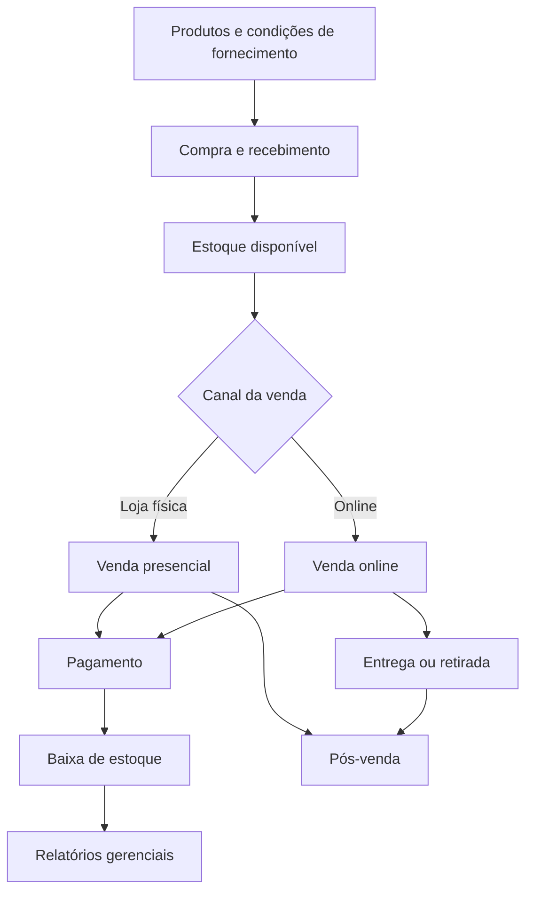
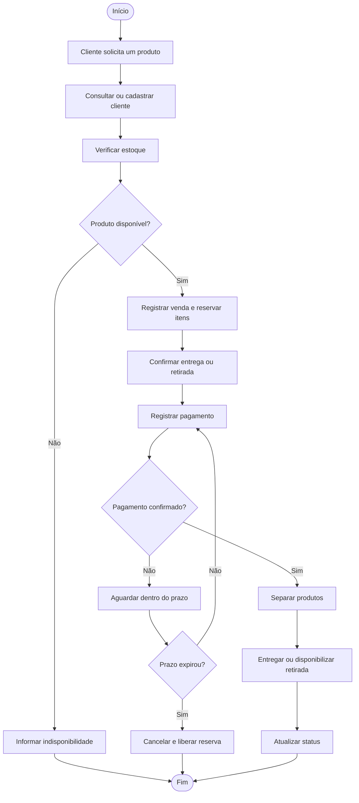
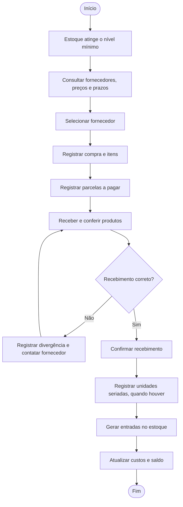
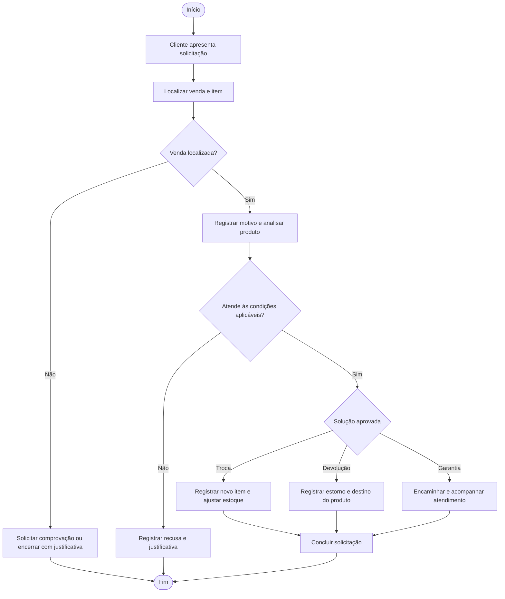
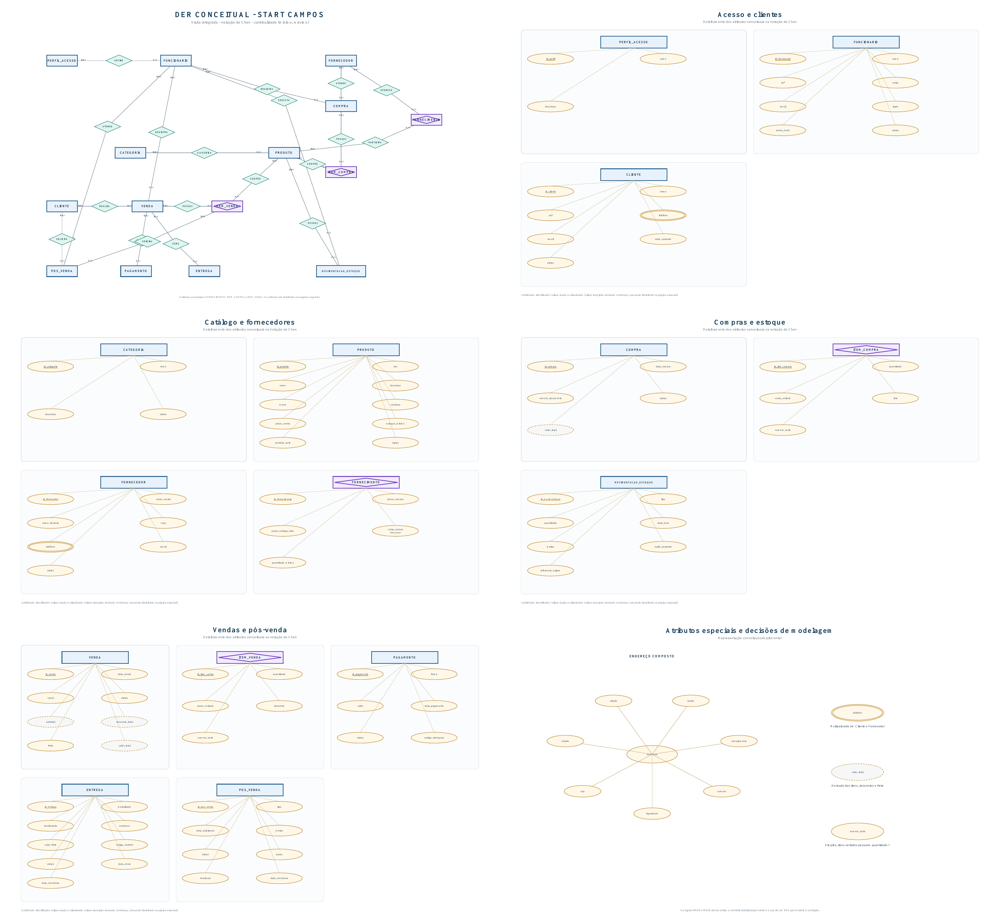

# Projeto ERP - Start Campos

> Entrega final do Projeto Integrador de Modelagem de Dados: do Modelo Conceitual ao Banco de Dados Implementado.

## Visão geral

Este projeto apresenta a análise, a modelagem e a implementação do banco de dados de um sistema ERP para a **Start Campos**, loja de pequeno porte especializada na venda de videogames, consoles e acessórios. O sistema integra as operações da loja física e dos canais de venda online, organizando informações de clientes, funcionários, produtos, estoque, fornecedores, compras, contas a pagar, vendas, pagamentos, entregas e pós-venda.

Na primeira entrega, a equipe percorreu o caminho do problema real ao DER. Na entrega final, o modelo foi revisado a partir da devolutiva do professor e convertido em banco de dados:

```text
DER -> Revisão do modelo conceitual -> Modelo lógico -> PK + FK + restrições
-> Normalização (1FN, 2FN, 3FN) -> Dicionário de dados -> Modelo físico -> SQL
-> Massa de dados -> Consultas -> Informação gerencial -> BI e IA
```

| Artefato | Onde está |
|---|---|
| Modelo lógico, normalização e restrições | [docs/modelo-logico/modelo-logico.md](docs/modelo-logico/modelo-logico.md) |
| Diagrama do modelo lógico | [docs/modelo-logico/modelo-logico.png](docs/modelo-logico/modelo-logico.png) |
| DER | [docs/der/](docs/der/) |
| Dicionário de dados | [docs/dicionario-dados-conceitual.md](docs/dicionario-dados-conceitual.md) (primeira entrega — em atualização) |
| Scripts SQL | `sql/` (em construção) |

---

## 1. Identificação do projeto

| Informação | Descrição |
|---|---|
| Projeto | ERP Start Campos |
| Grupo | 2 |
| Curso | Engenharia de Software |
| Instituição | UNICID |
| Disciplina | Modelagem de Dados |
| Professor | Clovis Jose Ramos Ferraro |
| SGBD | MySQL |

---

## 2. Integrantes

| Bruno Dutra | 47734248 |
| Eduarda Fernandes Barra Mansa | 47659661 |
| Gustavo Torres de Paula | 47349280 |
| Igor de Souza Sabino | 47407221 |
| Juliana Rodrigues | 49867075 |
| Lucas Pedrosa Colodro | 47399813 |
| Matheus Brizzi Gonçalves | 47454458 |
| Matheus Vitório Nascimento | 47603500 |
| Pedro Vasconcelos Sales | 47503092 |
| Rodrigo de Queiroz Souza Borges Filho | 47488085 |

---

## 3. Empresa e problema

### 3.1 Caracterização da empresa

#### 3.1.1 Identificação

| Informação | Descrição |
| --- | --- |
| Nome | Start Campos |
| Razão social localizada | Start Campos Ltda. |
| Segmento | Comércio varejista de videogames, consoles e acessórios eletrônicos |
| Localização | Rua Santa Ifigênia, 51, Santa Efigênia, São Paulo - SP |
| Canais de venda | Loja física e atendimento online |
| Público principal | Consumidores interessados em consoles, jogos e acessórios gamers |


#### 3.1.2 Produtos e serviços

A Start Campos comercializa consoles novos e seminovos, aparelhos de gerações atuais e anteriores, jogos e acessórios. O atendimento ocorre presencialmente e por canais digitais, pelos quais os clientes podem consultar produtos, negociar, realizar compras e solicitar entrega.

Um mesmo produto pode ser adquirido de fornecedores diferentes, com preço de compra e prazo de entrega próprios para cada combinação entre fornecedor e produto. Como a empresa também trabalha com seminovos, o controle deve considerar modelo, preço, condição, disponibilidade, número de série quando aplicável, garantia e histórico de movimentações.

#### 3.1.3 Áreas consideradas

- Administração e controle de usuários;
- Atendimento presencial e online;
- Cadastro de clientes;
- Catálogo de produtos e categorias;
- Controle de estoque;
- Compras e fornecedores;
- Vendas presenciais e online;
- Pagamentos e controle financeiro;
- Separação e entrega;
- Trocas, devoluções e garantias;
- Consultas gerenciais e relatórios.

#### 3.1.4 Funcionamento

Na loja física, o cliente consulta os produtos, recebe atendimento, escolhe os itens e realiza o pagamento. A venda deve reduzir o estoque e registrar o funcionário responsável.

No atendimento online, o cliente solicita informações, escolhe os produtos, informa os dados necessários e seleciona uma forma de pagamento. Após a confirmação, os itens são separados e a venda segue para entrega ou retirada.

Para repor o estoque, a empresa consulta fornecedores, registra a compra e confere os produtos recebidos. A entrada atualiza o saldo e preserva o histórico da movimentação. Nas solicitações de troca, devolução ou garantia, a venda original e o item envolvido precisam ser localizados.

#### 3.1.5 Informações essenciais

- Dados de clientes e funcionários:
- Produtos, categorias, marcas, condições e preços;
- Quantidades disponíveis e estoque mínimo;
- Fornecedores, produtos fornecidos, preços de compra e prazos;
- Vendas, itens, descontos e canais utilizados;
- Pagamentos e situações financeiras;
- Endereços, fretes e status das entregas;
- Números de série e comprovantes, quando aplicáveis;
- Trocas, garantias, motivos e soluções;
- Histórico de movimentações e responsáveis.

---

### 3.2 Justificativa da escolha

A Start Campos foi escolhida porque possui processos variados e integrados que podem ser representados por um sistema ERP. A operação simultânea de vendas físicas e online exige que informações de produtos, estoque, clientes, pagamentos e entregas permaneçam consistentes em todos os canais.

O trabalho com produtos novos e seminovos aumenta a necessidade de diferenciar a condição dos itens, registrar números de série quando necessário, acompanhar garantias e impedir a venda de produtos indisponíveis.

O negócio é adequado à disciplina porque permite transformar situações concretas em processos, requisitos, regras de negócio, entidades, relacionamentos e cardinalidades. A centralização dos dados pode reduzir divergências de estoque, duplicidade de cadastros, perda de registros e dificuldade para gerar relatórios.

### 3.3 Problemas e necessidades identificados

| ID | Problema | Consequência | Necessidade |
|---|---|---|---|
| P01 | Estoque físico e vendas online sem atualização centralizada | Venda de produto indisponível e divergência de saldo | Estoque único para todos os canais |
| P02 | Informações de produtos em controles separados | Preços, descrições e condições inconsistentes | Catálogo centralizado |
| P03 | Vendas online registradas manualmente | Perda de informações e dificuldade de acompanhamento | Registro estruturado das vendas online |
| P04 | Dados de clientes repetidos ou incompletos | Duplicidade e dificuldade no pós-venda | Cadastro único de clientes |
| P05 | Falta de rastreabilidade de seminovos e números de série | Dificuldade em trocas, garantias e origem do item | Controle de condição e série |
| P06 | Produtos e condições de fornecimento registrados separadamente | Dificuldade para comparar preços e prazos | Relacionar cada fornecedor aos produtos que oferece |
| P07 | Pagamentos e entregas acompanhados separadamente | Liberação incorreta e atrasos não identificados | Integração entre venda, pagamento e entrega |
| P08 | Trocas e garantias sem histórico centralizado | Retrabalho e falta de acompanhamento | Módulo de pós-venda |
| P09 | Relatórios produzidos manualmente | Demora e menor confiabilidade nas decisões | Relatórios automáticos |
| P10 | Alterações de estoque sem identificação do responsável | Dificuldade de auditoria | Histórico de movimentações |
| P11 | Obrigações com fornecedores sem controle por vencimento | O gestor não sabe quanto precisa pagar em cada período | Registrar parcelas a pagar vinculadas às compras |

O problema P11 foi acrescentado na entrega final, a partir da devolutiva da primeira entrega (controle financeiro).

---

## 4. Solução proposta

Um ERP com banco de dados único para a loja física e os canais online. Ele centraliza clientes, funcionários, catálogo, estoque, compras, vendas, pagamentos, entregas e pós-venda; mantém o histórico de cada movimentação de estoque com responsável e origem; rastreia cada unidade com número de série; e controla os recebimentos das vendas e as parcelas a pagar aos fornecedores.

### 4.1 Processos de negócio

| ID | Processo | Participantes | Evento inicial | Atividades principais | Informações geradas | Resultado |
|---|---|---|---|---|---|---|
| PR01 | Venda presencial | Cliente e funcionário | Cliente escolhe um produto | Consultar estoque, registrar itens e pagamento e atualizar saldo | Venda, itens, pagamento e movimentação | Venda concluída e estoque atualizado |
| PR02 | Venda online | Cliente, funcionário e entrega | Cliente solicita um produto | Identificar cliente, reservar itens, confirmar pagamento e separar | Cliente, venda, pagamento, endereço e entrega | Venda entregue ou retirada |
| PR03 | Reposição de estoque | Funcionário e fornecedor | Estoque baixo ou necessidade comercial | Comparar condições, registrar compra e conferir recebimento | Fornecimento, compra, itens e entrada | Produtos recebidos e saldo atualizado |
| PR04 | Gestão de produtos | Usuário autorizado | Inclusão ou alteração de produto | Conferir cadastro, categoria, condição, preço e estoque mínimo | Produto e categoria | Catálogo atualizado |
| PR05 | Atendimento ao cliente | Cliente e funcionário | Primeiro atendimento ou identificação | Consultar cadastro ou registrar cliente | Cadastro e histórico | Cliente identificado |
| PR06 | Troca, devolução ou garantia | Cliente e funcionário | Cliente apresenta solicitação | Localizar venda e item, analisar condições e registrar solução | Item vendido, motivo, prazo e solução | Atendimento concluído ou recusado |
| PR07 | Controle financeiro | Usuário autorizado | Compra, venda ou pagamento | Acompanhar os recebimentos das vendas e as parcelas a pagar aos fornecedores por vencimento | Recebimentos, contas a pagar, vencimentos e situação | Visão de recebimentos e obrigações |
| PR08 | Gestão de usuários | Administrador | Admissão, mudança de função ou desligamento | Cadastrar, associar perfil, alterar ou inativar usuário | Funcionário, perfil e status | Permissões atualizadas |

### 4.2 Integração dos processos



### 4.3 Fluxogramas

#### 4.3.1 Venda presencial


#### 4.3.2 Venda online



#### 4.3.3 Compra e reposição



#### 4.3.4 Troca, devolução ou garantia



---

## 5. Requisitos e regras de negócio

Itens alterados ou acrescentados na entrega final: **RF08, RF29, RF30, RN03, RN15, RN18, RN25, RN31 a RN35, PR07 e P11**. O motivo de cada alteração está na seção 15.

### 5.1 Requisitos funcionais

| ID | Requisito funcional |
|---|---|
| RF01 | O sistema deverá autenticar os usuários por login e senha. |
| RF02 | O sistema deverá cadastrar, consultar, alterar e desativar funcionários. |
| RF03 | O sistema deverá associar cada funcionário a um perfil de acesso. |
| RF04 | O sistema deverá cadastrar, consultar, alterar e inativar clientes. |
| RF05 | O sistema deverá identificar possíveis duplicidades de CPF, telefone ou e-mail. |
| RF06 | O sistema deverá cadastrar e organizar categorias. |
| RF07 | O sistema deverá cadastrar produtos com SKU, nome, marca, descrição, condição, preço e estoque mínimo. |
| RF08 | O sistema deverá registrar cada unidade de produto controlado por série e acompanhar sua situação desde a entrada até a saída do estoque. |
| RF09 | O sistema deverá cadastrar fornecedores e relacionar os produtos oferecidos, com preço e prazo. |
| RF10 | O sistema deverá registrar compras e seus respectivos itens. |
| RF11 | O sistema deverá atualizar o estoque após o recebimento de uma compra. |
| RF12 | O sistema deverá registrar entradas, saídas, reservas e ajustes de estoque. |
| RF13 | O sistema deverá alertar quando o saldo atingir o estoque mínimo. |
| RF14 | O sistema deverá registrar vendas realizadas na loja física. |
| RF15 | O sistema deverá registrar vendas originadas nos canais online. |
| RF16 | O sistema deverá verificar a disponibilidade antes de confirmar um item. |
| RF17 | O sistema deverá registrar itens, quantidades, preços e descontos de cada venda. |
| RF18 | O sistema deverá reservar ou baixar o estoque conforme o status da venda. |
| RF19 | O sistema deverá aceitar uma ou mais formas de pagamento na mesma venda. |
| RF20 | O sistema deverá controlar o status dos pagamentos. |
| RF21 | O sistema deverá registrar entregas, retiradas, endereços, fretes, rastreios e status. |
| RF22 | O sistema deverá cancelar vendas e estornar o estoque quando aplicável. |
| RF23 | O sistema deverá registrar trocas, devoluções e garantias vinculadas ao item vendido. |
| RF24 | O sistema deverá consultar o histórico de compras e atendimentos do cliente. |
| RF25 | O sistema deverá emitir relatórios de vendas, compras, estoque, pagamentos, entregas e pós-venda. |
| RF26 | O sistema deverá filtrar informações por período, cliente, produto, canal, status e funcionário. |
| RF27 | O sistema deverá registrar o usuário responsável pelas operações relevantes. |
| RF28 | O sistema deverá apresentar um painel com indicadores da operação. |
| RF29 | O sistema deverá registrar as parcelas a pagar de cada compra, com vencimento, valor e situação. |
| RF30 | O sistema deverá consultar as contas a pagar por período de vencimento e indicar as vencidas. |

### 5.2 Requisitos não funcionais

| ID | Categoria | Requisito não funcional |
|---|---|---|
| RNF01 | Segurança | As senhas deverão ser protegidas e nunca armazenadas em texto puro. |
| RNF02 | Acesso | Funções e dados deverão ser liberados conforme o perfil do usuário. |
| RNF03 | Auditoria | Vendas, cancelamentos, descontos e ajustes deverão registrar data, hora e responsável. |
| RNF04 | Privacidade | Dados pessoais deverão ser acessados apenas para finalidades operacionais autorizadas. |
| RNF05 | Desempenho | Consultas operacionais comuns deverão responder em até 3 segundos em condições normais. |
| RNF06 | Disponibilidade | O sistema deverá permanecer disponível durante o funcionamento da loja e dos canais online. |
| RNF07 | Confiabilidade | Uma operação confirmada não poderá atualizar apenas parte dos registros envolvidos. |
| RNF08 | Usabilidade | As telas deverão apresentar linguagem clara, campos identificados e retorno das ações. |
| RNF09 | Responsividade | A interface deverá funcionar em computadores, tablets e celulares. |
| RNF10 | Recuperação | O banco deverá possuir backups periódicos e procedimento de restauração testado. |
| RNF11 | Evolução | A estrutura deverá aceitar novas categorias, fornecedores, canais e entregas sem perder histórico. |

Os valores de desempenho, disponibilidade e periodicidade de backup são parâmetros propostos e devem ser validados com a empresa.

### 5.3 Regras de negócio

| ID | Regra |
|---|---|
| RN01 | Cada produto deve pertencer a exatamente uma categoria. |
| RN02 | Uma categoria pode existir sem produtos e classificar vários produtos. |
| RN03 | Uma venda pode ser aberta sem itens, mas só pode ser confirmada ou concluída se possuir pelo menos um item. |
| RN04 | Cada item de venda deve se referir a exatamente um produto. |
| RN05 | A quantidade vendida não pode ultrapassar a disponível, considerando reservas ativas. |
| RN06 | O estoque somente deve ser reduzido quando a venda atingir o status de confirmação. |
| RN07 | O cancelamento deve liberar a reserva ou devolver ao estoque os itens comercializáveis. |
| RN08 | Uma venda presencial pode ocorrer sem cliente identificado, salvo quando necessário para entrega, documento fiscal, garantia ou pós-venda. |
| RN09 | Toda venda online deve estar associada a um cliente identificado. |
| RN10 | Toda venda deve ser registrada por exatamente um funcionário. |
| RN11 | Uma venda pode possuir mais de um pagamento. |
| RN12 | A venda só será considerada paga quando os pagamentos confirmados atingirem o valor devido. |
| RN13 | Uma venda gera no máximo uma entrega; vendas de balcão ou retiradas podem não possuir entrega. |
| RN14 | Toda compra deve estar associada a exatamente um fornecedor e um funcionário responsável. |
| RN15 | Uma compra pode ser aberta sem itens, mas só pode ser confirmada se possuir pelo menos um item. |
| RN16 | O recebimento deve gerar movimentações de entrada para os produtos conferidos. |
| RN17 | Todo ajuste manual de estoque deve possuir motivo e funcionário responsável. |
| RN18 | Produtos seminovos têm a condição registrada no Produto (SKU próprio, RN26); o número de série e as observações da avaliação ficam na Unidade Serializada, quando aplicável. |
| RN19 | O pós-venda deve estar vinculado ao item vendido e a um cliente identificado. |
| RN20 | Troca, devolução ou garantia depende da venda, do produto, do prazo e da política aplicável. |
| RN21 | Cada funcionário deve possuir exatamente um perfil de acesso ativo por vez. |
| RN22 | Registros usados em operações concluídas não devem ser excluídos; devem ser inativados. |
| RN23 | Um fornecedor pode fornecer vários produtos, e um produto pode ser fornecido por vários fornecedores. |
| RN24 | Preço de compra, prazo de entrega, código do fornecedor e quantidade mínima pertencem à relação entre fornecedor e produto. |
| RN25 | Cada unidade de produto controlado por série é registrada como uma Unidade Serializada, ligada ao item de compra que lhe deu entrada e, quando vendida, ao item de venda. A quantidade do item corresponde ao número de unidades ligadas a ele. |
| RN26 | Cada SKU representa uma combinação específica de modelo e condição, como novo ou seminovo. |
| RN27 | Cada item de compra deve se referir a exatamente um produto. |
| RN28 | Cada movimentação de estoque deve se referir a exatamente um produto. |
| RN29 | Toda movimentação de estoque deve estar associada a exatamente um funcionário responsável, herdado da operação de origem ou informado no ajuste. |
| RN30 | Toda solicitação de pós-venda deve possuir exatamente um funcionário responsável. |
| RN31 | Uma compra pode gerar uma ou mais parcelas a pagar; cada parcela pertence a exatamente uma compra e é identificada pelo seu número dentro da compra. |
| RN32 | A soma das parcelas de uma compra deve corresponder ao valor total da compra. |
| RN33 | Uma parcela só pode ser considerada paga quando a data de pagamento estiver registrada. |
| RN34 | O número de série não pode se repetir para o mesmo produto; cada unidade serializada possui uma situação (em estoque, reservada, vendida, devolvida ou baixada). |
| RN35 | Toda movimentação de estoque se origina de no máximo uma operação (item de compra, item de venda ou pós-venda). O ajuste manual não possui operação de origem e exige motivo (RN17). |

### 5.4 Restrições e políticas organizacionais

| ID | Restrição ou política |
|---|---|
| RP01 | Apenas administradores podem gerenciar usuários e perfis. |
| RP02 | Descontos acima do limite interno exigem autorização de um administrador. |
| RP03 | Cancelamentos de vendas pagas devem registrar responsável e justificativa. |
| RP04 | Ajustes manuais de estoque exigem perfil autorizado e motivo obrigatório. |
| RP05 | Informações financeiras detalhadas ficam restritas aos perfis autorizados. |
| RP06 | A venda online só pode ser liberada após a confirmação do pagamento ou autorização registrada. |
| RP07 | A entrega deve usar o endereço confirmado e manter histórico de status. |
| RP08 | Trocas, devoluções e garantias devem obedecer à política vigente e à legislação aplicável. |
| RP09 | Produtos seminovos devem ser avaliados antes da venda. |
| RP10 | Dados pessoais não devem ser usados fora das finalidades informadas ao cliente. |
| RP11 | Backups devem ser executados regularmente e armazenados em local protegido. |
| RP12 | Prazos, descontos e garantias devem ser parametrizáveis, pois dependem de decisões internas. |

### 5.5 Matriz de rastreabilidade

| Problema ou necessidade | Requisitos | Regras e políticas | Elementos do modelo | Processo |
|---|---|---|---|---|
| P01 - Divergência de estoque | RF11, RF12, RF16 e RF18 | RN05, RN06, RN07 e RN16 | Produto, ItemVenda e MovimentacaoEstoque | PR01, PR02 e PR03 |
| P03 - Registro manual online | RF15, RF18, RF20 e RF21 | RN09, RN12, RN13 e RP06 | Cliente, Venda, Pagamento e Entrega | PR02 |
| P04 - Duplicidade de clientes | RF04, RF05 e RF24 | RN08, RN09, RN19 e RN22 | Cliente, Venda e PosVenda | PR02, PR05 e PR06 |
| P05 - Rastreabilidade de seminovos | RF07, RF08 e RF23 | RN18, RN19, RN20, RN25, RN34 e RP09 | Produto, UnidadeSerializada, ItemCompra, ItemVenda e PosVenda | PR03, PR04 e PR06 |
| P06 - Condições de fornecimento | RF09 e RF10 | RN14, RN23 e RN24 | Fornecedor, Produto, Fornecimento e Compra | PR03 |
| P07 - Pagamento e entrega separados | RF19, RF20 e RF21 | RN11, RN12, RN13, RP06 e RP07 | Venda, Pagamento e Entrega | PR01 e PR02 |
| P08 - Pós-venda sem histórico | RF23 e RF24 | RN19, RN20, RN30 e RP08 | Cliente, ItemVenda e PosVenda | PR06 |
| P10 - Movimentação sem responsável | RF12 e RF27 | RN16, RN17, RN28, RN29, RN35, RP03 e RP04 | Produto, Funcionario, MovimentacaoEstoque, ItemCompra, ItemVenda e PosVenda | PR01, PR03 e PR06 |
| P11 - Contas a pagar sem controle | RF29 e RF30 | RN31, RN32 e RN33 | Compra e ContaPagar | PR03 e PR07 |

### 5.6 Escopo financeiro

| Dentro do escopo | Fora do escopo |
|---|---|
| Recebimentos das vendas, em uma ou mais formas de pagamento | Crediário próprio ou contas a receber parceladas de clientes |
| Parcelas a pagar aos fornecedores, com vencimento e situação | Fluxo de caixa completo, conciliação bancária e contabilidade |
| Consulta de vencimentos e contas em atraso | Despesas que não vêm de compras (aluguel, salários, impostos) |

> Pendente de validação com a empresa: confirmar que a Start Campos compra dos fornecedores a prazo e não oferece crediário próprio.

---

## 6. DER atualizado

O DER utiliza a **notação de Chen** e permanece no nível conceitual: as ligações aparecem como relacionamentos, sem chaves estrangeiras. As chaves estrangeiras e as chaves compostas aparecem somente no modelo lógico (seção 7).



> ⚠️ A imagem acima ainda é o DER da primeira entrega. Ela deve ser atualizada com as entidades e cardinalidades das tabelas abaixo.

### 6.1 Entidades

| Entidade | Tipo | Finalidade | Situação |
|---|---|---|---|
| Cliente | Forte | Representar a pessoa atendida e seu histórico | Primeira entrega |
| Funcionario | Forte | Identificar quem executa as operações | Primeira entrega |
| Cargo | Forte | Descrever os cargos da empresa | **Nova** |
| HistoricoSalario | Forte | Registrar o salário do funcionário em cada cargo e período | **Nova** |
| PerfilAcesso | Forte | Definir conjuntos de permissões | Primeira entrega |
| Categoria | Forte | Organizar o catálogo | Primeira entrega |
| Produto | Forte | Representar cada item comercializado | Primeira entrega |
| Estoque | Forte | Guardar o saldo atual e o estoque mínimo de cada produto | **Nova** |
| UnidadeSerializada | Forte | Representar cada unidade física com número de série | **Nova** (devolutiva) |
| MovimentacaoEstoque | Forte | Manter o histórico do saldo | Primeira entrega (revisada) |
| Fornecedor | Forte | Representar quem fornece os produtos | Primeira entrega |
| Fornecimento | Associativa | Relacionar fornecedor e produto e registrar as condições | Primeira entrega |
| Compra | Forte | Registrar uma aquisição | Primeira entrega |
| ItemCompra | Associativa | Relacionar produtos a cada compra | Primeira entrega (revisada) |
| ContaPagar | Fraca (dona: Compra) | Registrar as parcelas a pagar de cada compra | **Nova** (devolutiva) |
| Venda | Forte | Registrar uma operação física ou online | Primeira entrega |
| ItemVenda | Associativa | Relacionar produtos a cada venda | Primeira entrega (revisada) |
| FormaPagamento | Forte | Cadastrar as formas de pagamento aceitas | **Nova** |
| VendaPagamento | Forte | Registrar os valores recebidos de cada venda | Primeira entrega (antiga Pagamento) |
| Entrega | Forte | Acompanhar o envio ou a retirada de uma venda | Primeira entrega |
| PosVenda | Forte | Registrar troca, devolução ou garantia | Primeira entrega |

### 6.2 Atributos

| Entidade | Atributos |
|---|---|
| Cliente | `id_Cliente`, `sobrenome`, `nome`, `CPF`, `data_nascimento`, `tipo_cliente`, `telefone` (multivalorado: DDI, DDD, código da operadora, número, tipo), `email` (multivalorado: e-mail, tipo) |
| Funcionario | `id_funcionario`, `sobrenome`, `nome`, `CPF`, `data_admissao`, `login`, `senha_hash`, `telefone` (multivalorado), `email` (multivalorado) |
| Cargo | `id_cargo`, `tipo`, `Descrição` |
| HistoricoSalario | `id_historico_salario`, `salario`, `data_inicio`, `data_fim` |
| PerfilAcesso | `id_perfil`, `nome_perfil`, `descricao` |
| Categoria | `id_Categoria`, `Tipo_categoria` |
| Produto | `id_Produto`, `Nome_produto`, `preco_unitario`, `condicao`, `controla_serie` |
| Estoque | `id_estoque`, `Quantidade`, `Estoque_Minimo`, `Data_Atualização` |
| UnidadeSerializada | `id_unidade`, `numero_serie`, `observacoes`, `status_unidade` |
| MovimentacaoEstoque | `ID_Movimentação`, `Quantidade`, `tipo_movimentação`, `Data_movimentação`, `Motivo` |
| Fornecedor | `id_fornecedor`, `razao_social`, `endereço_fornecedor`, `cnpj` |
| Fornecimento | `preco_compra`, `prazo_entrega_dias`, `codigo_produto_fornecedor`, `quantidade_minima` |
| Compra | `id_compra`, `data_compra`, `status_compra`, `valor_total`, `nota_fiscal` |
| ItemCompra | `Quantidade`, `preco_custo` |
| ContaPagar | `nr_parcela` (identificador parcial), `valor_parcela`, `data_vencimento`, `data_pagamento`, `status_parcela` |
| Venda | `id_Venda`, `Data_Venda`, `Status_Venda`, `canal` |
| ItemVenda | `Quantidade`, `preco_unitario`, `desconto_unitario` |
| FormaPagamento | `id_Forma_Pagamento`, `tipo_forma_pagamento` |
| VendaPagamento | `id_Venda_Pagamento`, `valor_pago`, `data_pagamento`, `status_pagamento` |
| Entrega | `id_entrega`, `modalidade`, `destinatario`, `endereco` (composto: CEP, logradouro, número, complemento, bairro, cidade, UF), `valor_frete`, `codigo_rastreio`, `status_entrega`, `data_envio`, `data_conclusao` |
| PosVenda | `id_posvenda`, `data_contato`, `tipo`, `descricao`, `status`, `data_resolucao` |

Removidos em relação à primeira entrega: `numero_serie` dos itens (agora em UnidadeSerializada), `referencia_origem` da movimentação (agora relacionamentos "origina") e `frete` de Venda (fica em Entrega).

### 6.3 Relacionamentos N:N

1. **Venda e Produto**, resolvido por **ItemVenda** (quantidade, preço praticado e desconto).
2. **Compra e Produto**, resolvido por **ItemCompra** (quantidade e preço de custo).
3. **Fornecedor e Produto**, resolvido por **Fornecimento** (preço de compra, prazo, código do fornecedor e quantidade mínima), cujos atributos dependem do par fornecedor × produto (RN24).

### 6.4 Cardinalidades

| Entidade A | Cardinalidade A | Relacionamento | Cardinalidade B | Entidade B | Base |
|---|:---:|---|:---:|---|---|
| PerfilAcesso | (0,N) | define | (1,1) | Funcionario | RN21 |
| Cargo | (0,N) | classifica | (1,1) | Funcionario | — |
| Funcionario | (0,N) | possui | (1,1) | HistoricoSalario | — |
| Cargo | (0,N) | referencia | (1,1) | HistoricoSalario | — |
| Cliente | (0,N) | realiza | (0,1) | Venda | RN08 e RN09 |
| Funcionario | (0,N) | registra | (1,1) | Venda | RN10 |
| Venda | **(0,N)** | possui | (1,1) | ItemVenda | RN03 revisada |
| Produto | (0,N) | compõe | (1,1) | ItemVenda | RN04 |
| Venda | (0,N) | recebe | (1,1) | VendaPagamento | RN11 e RN12 |
| FormaPagamento | (0,N) | classifica | (1,1) | VendaPagamento | RF19 |
| Venda | (0,1) | gera | (1,1) | Entrega | RN13 |
| ItemVenda | (0,N) | origina | (1,1) | PosVenda | RN19 e RN20 |
| Cliente | (0,N) | solicita | (1,1) | PosVenda | RN19 |
| Funcionario | (0,N) | atende | (1,1) | PosVenda | RN30 |
| Categoria | (0,N) | classifica | (1,1) | Produto | RN01 e RN02 |
| Produto | (1,1) | possui | (1,1) | Estoque | RF13 |
| Fornecedor | (0,N) | oferece | (1,1) | Fornecimento | RN23 e RN24 |
| Produto | (0,N) | participa | (1,1) | Fornecimento | RN23 e RN24 |
| Fornecedor | (0,N) | atende | (1,1) | Compra | RN14 |
| Funcionario | (0,N) | registra | (1,1) | Compra | RN14 |
| Compra | **(0,N)** | possui | (1,1) | ItemCompra | RN15 revisada |
| Produto | (0,N) | compõe | (1,1) | ItemCompra | RN27 |
| Compra | (0,N) | gera | (1,1) | ContaPagar | RN31 |
| ItemCompra | (0,N) | dá entrada | (1,1) | UnidadeSerializada | RN25 |
| ItemVenda | (0,N) | vende | (0,1) | UnidadeSerializada | RN25 |
| Produto | (0,N) | possui | (1,1) | MovimentacaoEstoque | RN16 e RN28 |
| Funcionario | (0,N) | executa | (1,1) | MovimentacaoEstoque | RN17 e RN29 |
| ItemCompra | (0,N) | origina | (0,1) | MovimentacaoEstoque | RN16 e RN35 |
| ItemVenda | (0,N) | origina | (0,1) | MovimentacaoEstoque | RN06, RN07 e RN35 |
| PosVenda | (0,N) | origina | (0,1) | MovimentacaoEstoque | RN35 |
| UnidadeSerializada | (0,N) | movimenta | (0,1) | MovimentacaoEstoque | RN34 |

### 6.5 Legenda

- Retângulo: entidade forte · Retângulo duplo: entidade fraca
- Losango: relacionamento · Losango duplo: relacionamento identificador
- Retângulo envolvendo losango: entidade associativa
- Elipse: atributo simples · Elipse dupla: multivalorado · Elipse tracejada: derivado
- Sublinhado: identificador · Pares como `(0,N)` e `(1,1)`: cardinalidade mínima e máxima

---

## 7. Modelo lógico

O DER foi convertido em **25 tabelas**, a partir do diagrama de tabelas da equipe e com as correções da devolutiva. O documento completo mostra a conversão de cada relacionamento e cardinalidade, as chaves primárias com justificativa, a normalização e as restrições: [docs/modelo-logico/modelo-logico.md](docs/modelo-logico/modelo-logico.md).


| Classificação | Tabelas |
|---|---|
| Fortes | Cliente, Funcionario, Cargo, Historico_salario, Perfil_Acesso, Categoria, Produto, Estoque, Unidade_Serializada, Movimentação_Estoque, Fornecedor, Compra, Venda, forma_Pagamento, Venda_Pagamento, Entrega, PosVenda |
| Vindas da 1FN (atributos multivalorados) | Cliente_Telefone, Cliente_email, telefone_funcionario, email_funcionario |
| Associativas (N:N) | Item_Venda `(id_Venda, id_produto)`, Item_Compra `(id_Compra, id_produto)`, Fornecimento `(id_fornecedor, id_produto)` |
| Fraca | Conta_Pagar `(id_compra, nr_parcela)` |

Principais conversões:

- **1:N** → chave estrangeira do lado N (ex.: `Venda.id_Funcionario`).
- **Participação mínima 0** → FK que aceita NULL (ex.: `Venda.id_Cliente`, pois a venda de balcão pode não ter cliente — RN08).
- **1:1** → FK com UNIQUE (ex.: `Entrega.id_venda` — RN13; `Estoque.id_produto`).
- **N:N** → tabela associativa com PK composta herdada das duas tabelas.
- **Entidade fraca** → PK formada pela chave da dona + número sequencial (`Conta_Pagar`).

---

## 8. Normalização

Cada caso está documentado como **estrutura analisada → dependência funcional → problema → correção** na [seção 5 do modelo lógico](docs/modelo-logico/modelo-logico.md#5-normalização). Todos os casos são situações reais do DER da primeira entrega ou do diagrama da equipe.

| Forma normal | Estrutura analisada | Problema | Correção |
|---|---|---|---|
| 1FN | Cliente e Funcionario com `telefone` e `email` | Atributos multivalorados | Tabelas Cliente_Telefone, Cliente_email, telefone_funcionario e email_funcionario |
| 1FN | Entrega com `endereco` | Atributo composto | Colunas atômicas (CEP, logradouro, número, complemento, bairro, cidade, UF) |
| 1FN | Venda_Pagamento com `id_produto` | Um pagamento quita a venda inteira, que tem vários produtos | `id_produto` removido; produtos ficam em Item_Venda |
| 2FN | Fornecedor com `id_produto` e `quantidade` | `endereço_fornecedor` e `cnpj` dependeriam só de parte da chave (id_fornecedor, id_produto) | Fornecedor separado de Fornecimento |
| 2FN | Compra com `id_produto` | Data, fornecedor e nota fiscal dependeriam só de `id_compra` | `id_produto` removido; produtos ficam em Item_Compra |
| 3FN | Funcionario com `cargo` | A descrição do cargo dependeria do cargo, não do funcionário | Tabela Cargo |
| 3FN | `numero_serie` nos itens | Dados da unidade física dependiam do número de série | Tabela Unidade_Serializada |
| 3FN | `frete` em Venda e em Entrega | Mesmo dado em duas tabelas | Frete apenas em Entrega |

---

## 9. Dicionário de Dados

> Em atualização. O dicionário será refeito a partir do modelo lógico, com tipo, tamanho, PK, FK, NULL, UNIQUE, DEFAULT e regra de cada atributo, e deverá representar exatamente o banco implementado em SQL.

Dicionário da primeira entrega (histórico): [docs/dicionario-dados-conceitual.md](docs/dicionario-dados-conceitual.md).

---

## 10. Implementação SQL

> Em construção pela equipe.

O script MySQL implementará o modelo lógico da seção 7, com `CREATE DATABASE`, `CREATE TABLE`, PK, FK, `NOT NULL`, `UNIQUE`, `CHECK` e `DEFAULT`. As tabelas independentes serão criadas primeiro, seguidas das que dependem delas. O teste será feito em banco vazio, executando o script do início ao fim.

---

## 11. Massa de Dados

> Em construção pela equipe.

A massa de dados deverá ter diferentes clientes, produtos novos e seminovos, vendas na loja e online, compras com parcelas e unidades seriadas, para testar relacionamentos, restrições e consultas. Os prompts de IA usados na geração em escala serão documentados no repositório.

---

## 12. Consultas Gerenciais

> SQL em construção pela equipe.

| Pergunta do gestor | Tabelas |
|---|---|
| Quais produtos mais venderam no período? | Venda, Item_Venda, Produto |
| Qual foi o faturamento por mês e por canal (loja × online)? | Venda, Item_Venda, Entrega |
| Quais clientes mais compram? | Cliente, Venda, Item_Venda |
| Quais produtos estão abaixo do estoque mínimo? | Produto, Estoque |
| Quanto a loja tem a pagar nos próximos 7 dias, por fornecedor? | Conta_Pagar, Compra, Fornecedor |
| Qual fornecedor oferece o menor preço e prazo para cada produto? | Fornecimento, Fornecedor, Produto |
| Quais produtos têm mais trocas, devoluções e garantias? | PosVenda, Item_Venda, Produto |
| Quais seminovos estão parados no estoque há mais de 60 dias? | Unidade_Serializada, Compra, Produto |

---

## 13. Consultas de Auditoria

> SQL em construção pela equipe.

| O que a consulta verifica | Regra |
|---|---|
| Vendas concluídas sem nenhum item | RN03 |
| Compras confirmadas sem nenhum item | RN15 |
| Itens de produto seriado cuja quantidade difere do número de unidades ligadas | RN25 |
| Compras cuja soma das parcelas difere do valor total | RN32 |
| Compras cujo valor total difere da soma dos itens | Coerência de `valor_total` |
| Produtos cujo saldo em Estoque difere do saldo das movimentações | Coerência de `Estoque.Quantidade` |
| Contas a pagar vencidas e ainda abertas | RF30 |
| Ajustes manuais de estoque por funcionário no período | RN17 e RP04 |

---

## 14. Potencial para BI e IA

| Dado | Informação | Decisão |
|---|---|---|
| Itens de venda com data e preço praticado | Produtos mais vendidos por período e canal | Reorganizar estoque e compras |
| Estoque e estoque mínimo | Produtos abaixo do mínimo | Repor antes de faltar |
| Fornecimento | Melhor fornecedor por produto | Escolher de quem comprar |
| Item de compra e item de venda | Margem por produto | Ajustar preços |
| Contas a pagar com vencimento | Total a pagar por semana | Planejar o caixa |
| Unidades seriadas em estoque | Seminovos parados | Fazer promoção ou rever preço |

**Indicadores propostos:** faturamento, ticket médio, margem bruta por produto, giro de estoque, participação por canal, taxa de pós-venda por produto, contas a pagar em 7 e 30 dias e tempo médio do seminovo em estoque.

**BI — painel comercial.** Pergunta: como as vendas evoluíram nos últimos meses, por canal e por categoria? Dados: Venda + Item_Venda + Produto + Categoria. Benefício: perceber a sazonalidade (lançamentos de consoles, fim de ano) e decidir quando reforçar estoque e promoções.

**BI — painel financeiro.** Pergunta: quanto entra e quanto sai nas próximas semanas? Dados: Venda_Pagamento + Conta_Pagar + Compra + Fornecedor. Benefício: responder à pergunta da devolutiva — "quanto tenho a pagar esta semana?" — e evitar atrasos com fornecedores.

**IA — previsão de demanda.** Problema: a loja compra por intuição e pode ficar sem consoles nas datas de maior procura. Dados: histórico de Item_Venda + Venda + Produto + Movimentação_Estoque. Análise: modelo de série temporal por produto. Benefício: compras mais precisas e menos capital parado.

**IA — sugestão de preço para seminovos.** Problema: o preço do seminovo depende da avaliação do funcionário. Dados: Unidade_Serializada (observações) + Produto + Item_Compra (custo) + Item_Venda (preço praticado) + tempo em estoque. Análise: regressão que estima o preço com maior chance de venda. Benefício: precificação padronizada e menos tempo de seminovo parado.

---

## 15. Histórico e evolução do projeto

| Etapa | Resultado |
|---|---|
| Primeira entrega | Problema real → requisitos → regras → DER conceitual (nota 7,75 — "objetivo central atingido com inconsistências") |
| Revisão | Devolutiva tratada ponto a ponto e modelo lógico construído a partir do diagrama de tabelas da equipe |
| Entrega final | Modelo lógico normalizado, dicionário de dados, scripts SQL, consultas e análise de BI e IA |

### 15.1 Pontos da devolutiva

| Ponto da devolutiva | Como foi tratado |
|---|---|
| Controle financeiro ("peça sem destino") | Nova entidade ContaPagar, problema P11, RF29, RF30, RN31 a RN33 e PR07 revisado; escopo financeiro declarado (seção 5.6) |
| Ciclo de vida da Venda | Venda (0,N) ItemVenda e Compra (0,N) ItemCompra; RN03 e RN15 revisadas; verificação por consulta de auditoria |
| Número de série | Nova entidade UnidadeSerializada (RN25 e RN34) |
| Origem da movimentação | `referencia_origem` substituído por relacionamentos com ItemCompra, ItemVenda e PosVenda (RN35) |
| Separar conceitual e lógico | DER sem FKs; chaves estrangeiras e compostas só no modelo lógico |

### 15.2 Principais alterações de modelagem

| O que foi alterado? | Como era? | Como ficou? | Por que alteramos? |
|---|---|---|---|
| Cardinalidade Venda–ItemVenda | (1,N) | (0,N) | A venda em elaboração pode existir sem itens |
| Cardinalidade Compra–ItemCompra | (1,N) | (0,N) | A compra aberta pode existir sem itens |
| Número de série | Atributo de ItemCompra e ItemVenda | Entidade UnidadeSerializada | Representar a unidade física durante toda a permanência no estoque |
| Origem da movimentação | Atributo de texto | Relacionamentos | Garantir que a operação de origem existe |
| Contas a pagar | — | Entidade ContaPagar | Controlar obrigações com fornecedores por vencimento |
| Telefone e e-mail | Atributos multivalorados | Tabelas próprias | 1FN |
| Cargo | Atributo de Funcionario | Entidade Cargo e HistoricoSalario | 3FN e histórico de salários |
| Forma de pagamento | Atributo de Pagamento | Entidade FormaPagamento | Cadastro único das formas aceitas |
| Estoque | Saldo nas movimentações | Entidade Estoque | Consulta rápida do saldo e do estoque mínimo |
| Frete | Em Venda e em Entrega | Somente em Entrega | Evitar o mesmo dado em dois lugares |

### 15.3 Organização do repositório

```text
Projeto-Integrador-Modelagem-de-Dados/
├── README.md
├── docs/
│   ├── der/                         DER conceitual
│   ├── modelo-logico/               modelo lógico, normalização e diagrama
│   ├── dicionario-dados-conceitual.md
│   └── checklist-entrega.md
├── sql/                             scripts MySQL (em construção)
├── evidencias/                      prints dos testes (em construção)
└── apresentacao/
```

---

## 16. Conclusão

A revisão mostrou que um modelo pode estar bem construído e, ainda assim, não se encaixar em todas as peças do projeto. O controle financeiro aparecia nos processos, mas não no DER. O número de série estava nos itens, mas a unidade física não existia enquanto estava no estoque. A origem das movimentações era um texto que o banco não conseguia validar. Responder às perguntas "onde esta necessidade chegou no DER?" e "de qual necessidade surgiu este elemento?" levou às entidades ContaPagar e UnidadeSerializada e aos novos relacionamentos.

Na conversão para o modelo lógico, a normalização deixou cada fato em um único lugar: o fornecedor separado das condições de fornecimento, a compra separada dos seus produtos, telefones e e-mails em tabelas próprias. Cada restrição passou a ter origem em uma regra de negócio, e as regras que envolvem mais de uma tabela serão verificadas por consultas de auditoria. Com o banco implementado, os dados de vendas, estoque, compras e contas a pagar passam a responder às perguntas do gestor e abrem caminho para BI e IA.

---

## Fontes consultadas

- [Instagram da Start Campos](https://www.instagram.com/startcampos_/)
- **Manual da Primeira Entrega** e **Manual da Entrega Final — Projeto Integrador de Modelagem de Dados**, disponibilizados pela disciplina.
- **Devolutiva da primeira entrega — Grupo 2**, Prof. Clóvis.
- Aulas de Modelagem de Dados: do mundo real ao DER; entidade forte × fraca × associativa; normalização (Aula 8); DDL, chaves e integridade referencial (Aula 9); DML e validação dos dados (Aula 10).
