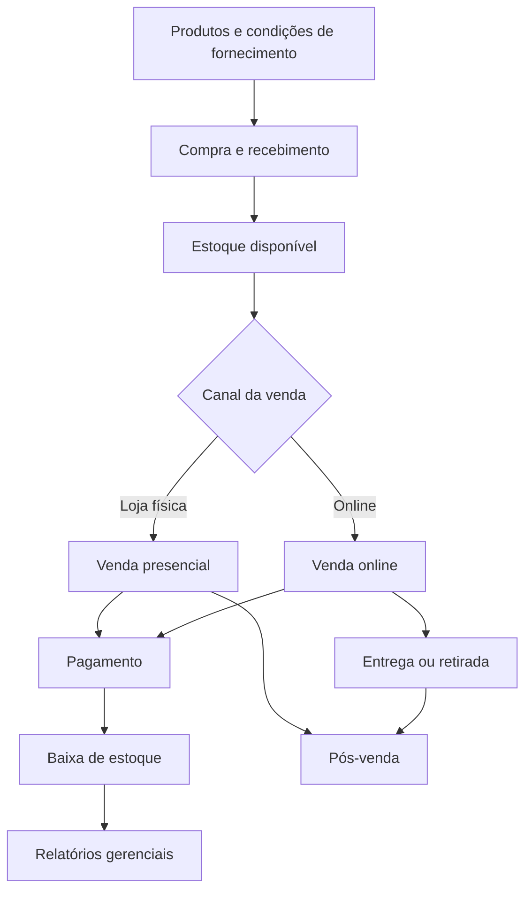
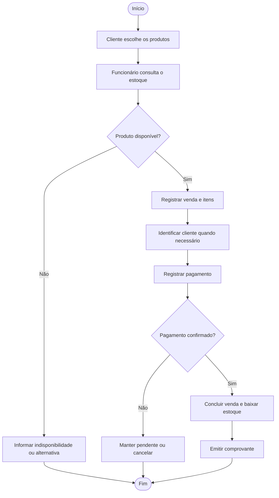
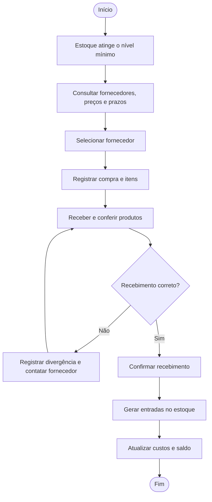
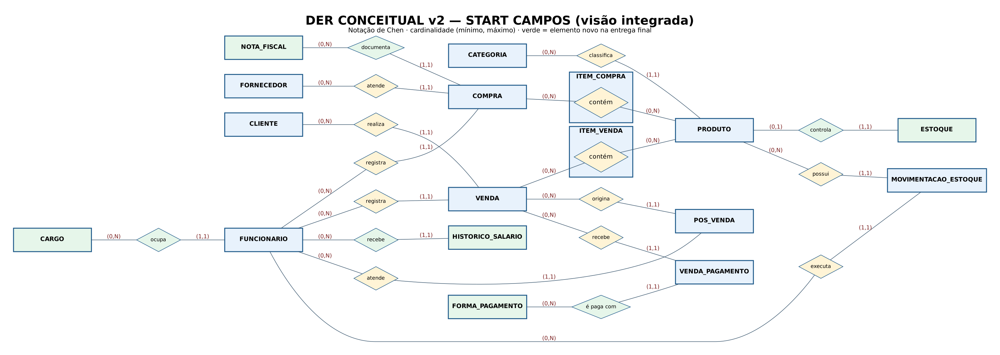
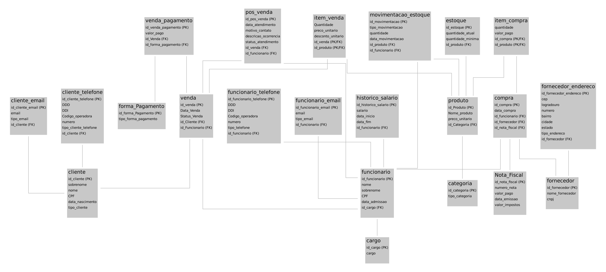

# Projeto ERP - Start Campos

> Entrega final do Projeto Integrador de Modelagem de Dados: do Modelo Conceitual ao Banco de Dados Implementado.

## Visão geral

Este projeto apresenta a análise, a modelagem e a implementação do banco de dados de um sistema ERP para a **Start Campos**, loja de pequeno porte especializada na venda de videogames, consoles e acessórios. O banco organiza clientes, funcionários, catálogo, estoque, fornecedores, compras com nota fiscal, vendas, pagamentos e pós-venda.

Na primeira entrega, a equipe percorreu o caminho do problema real ao DER. Na entrega final, o modelo foi revisado a partir da devolutiva do professor e implementado em MySQL:

```text
DER -> Revisão do modelo conceitual -> Modelo lógico -> PK + FK + restrições
-> Normalização (1FN, 2FN, 3FN) -> Dicionário de dados -> Modelo físico -> SQL
-> Massa de dados -> Consultas -> Informação gerencial -> BI e IA
```

| Artefato | Onde está |
|---|---|
| DER conceitual atualizado | [docs/der/](docs/der/README.md) |
| Modelo lógico, normalização e restrições | [docs/modelo-logico/modelo-logico.md](docs/modelo-logico/modelo-logico.md) |
| Dicionário de dados | [docs/dicionario-dados/dicionario-dados.md](docs/dicionario-dados/dicionario-dados.md) |
| Scripts SQL | [sql/](sql/README.md) |
| Evidências dos testes | [evidencias/](evidencias/) |
| Uso de IA | [docs/prompts-ia.md](docs/prompts-ia.md) |
| Checklist da entrega final | [docs/checklist-entrega-final.md](docs/checklist-entrega-final.md) |

---

## 1. Identificação do projeto

| Informação | Descrição |
|---|---|
| Projeto | ERP Start Campos |
| Grupo | 2 |
| Curso | Engenharia de Software |
| Instituição | UNICID |
| Disciplina | Modelagem de Dados |
| Professor | Clovis Jose Ramos Ferraro |
| SGBD | MySQL 8.0.16 ou superior |
| Banco | `sistema_comercial` |

---

## 2. Integrantes

| Bruno Dutra | 47734248 |
| Eduarda Fernandes Barra Mansa | 47659661 |
| Gustavo Torres de Paula | 47349280 |
| Igor de Souza Sabino | 47407221 |
| Juliana Rodrigues | 49867075 |
| Lucas Pedrosa Colodro | 47399813 |
| Matheus Brizzi Gonçalves | 47454458 |
| Matheus Vitório Nascimento | 47603500 |
| Pedro Vasconcelos Sales | 47503092 |
| Rodrigo de Queiroz Souza Borges Filho | 47488085 |

---

## 3. Empresa e problema

### 3.1 Caracterização da empresa

#### 3.1.1 Identificação

| Informação | Descrição |
| --- | --- |
| Nome | Start Campos |
| Razão social localizada | Start Campos Ltda. |
| Segmento | Comércio varejista de videogames, consoles e acessórios eletrônicos |
| Localização | Rua Santa Ifigênia, 51, Santa Efigênia, São Paulo - SP |
| Canais de venda | Loja física e atendimento online |
| Público principal | Consumidores interessados em consoles, jogos e acessórios gamers |


#### 3.1.2 Produtos e serviços

A Start Campos comercializa consoles novos e seminovos, aparelhos de gerações atuais e anteriores, jogos e acessórios. O atendimento ocorre presencialmente e por canais digitais, pelos quais os clientes podem consultar produtos, negociar, realizar compras e solicitar entrega.

Um mesmo produto pode ser adquirido de fornecedores diferentes, com preço de compra e prazo de entrega próprios para cada combinação entre fornecedor e produto. Como a empresa também trabalha com seminovos, o controle deve considerar modelo, preço, condição, disponibilidade, número de série quando aplicável, garantia e histórico de movimentações.

#### 3.1.3 Áreas consideradas

- Administração e controle de usuários;
- Atendimento presencial e online;
- Cadastro de clientes;
- Catálogo de produtos e categorias;
- Controle de estoque;
- Compras e fornecedores;
- Vendas presenciais e online;
- Pagamentos e controle financeiro;
- Separação e entrega;
- Trocas, devoluções e garantias;
- Consultas gerenciais e relatórios.

#### 3.1.4 Funcionamento

Na loja física, o cliente consulta os produtos, recebe atendimento, escolhe os itens e realiza o pagamento. A venda deve reduzir o estoque e registrar o funcionário responsável.

No atendimento online, o cliente solicita informações, escolhe os produtos, informa os dados necessários e seleciona uma forma de pagamento. Após a confirmação, os itens são separados e a venda segue para entrega ou retirada.

Para repor o estoque, a empresa consulta fornecedores, registra a compra e confere os produtos recebidos. A entrada atualiza o saldo e preserva o histórico da movimentação. Nas solicitações de troca, devolução ou garantia, a venda original e o item envolvido precisam ser localizados.

#### 3.1.5 Informações essenciais

- Dados de clientes e funcionários:
- Produtos, categorias, marcas, condições e preços;
- Quantidades disponíveis e estoque mínimo;
- Fornecedores, produtos fornecidos, preços de compra e prazos;
- Vendas, itens, descontos e canais utilizados;
- Pagamentos e situações financeiras;
- Endereços, fretes e status das entregas;
- Números de série e comprovantes, quando aplicáveis;
- Trocas, garantias, motivos e soluções;
- Histórico de movimentações e responsáveis.

---

### 3.2 Justificativa da escolha

A Start Campos foi escolhida porque possui processos variados e integrados que podem ser representados por um sistema ERP. A operação simultânea de vendas físicas e online exige que informações de produtos, estoque, clientes, pagamentos e entregas permaneçam consistentes em todos os canais.

O trabalho com produtos novos e seminovos aumenta a necessidade de diferenciar a condição dos itens, registrar números de série quando necessário, acompanhar garantias e impedir a venda de produtos indisponíveis.

O negócio é adequado à disciplina porque permite transformar situações concretas em processos, requisitos, regras de negócio, entidades, relacionamentos e cardinalidades. A centralização dos dados pode reduzir divergências de estoque, duplicidade de cadastros, perda de registros e dificuldade para gerar relatórios.

### 3.3 Problemas e necessidades identificados

| ID | Problema | Consequência | Necessidade |
|---|---|---|---|
| P01 | Estoque físico e vendas online sem atualização centralizada | Venda de produto indisponível e divergência de saldo | Estoque único para todos os canais |
| P02 | Informações de produtos em controles separados | Preços, descrições e condições inconsistentes | Catálogo centralizado |
| P03 | Vendas online registradas manualmente | Perda de informações e dificuldade de acompanhamento | Registro estruturado das vendas online |
| P04 | Dados de clientes repetidos ou incompletos | Duplicidade e dificuldade no pós-venda | Cadastro único de clientes |
| P05 | Falta de rastreabilidade de seminovos e números de série | Dificuldade em trocas, garantias e origem do item | Controle de condição e série |
| P06 | Produtos e condições de fornecimento registrados separadamente | Dificuldade para comparar preços e prazos | Relacionar cada fornecedor aos produtos que oferece |
| P07 | Pagamentos e entregas acompanhados separadamente | Liberação incorreta e atrasos não identificados | Integração entre venda, pagamento e entrega |
| P08 | Trocas e garantias sem histórico centralizado | Retrabalho e falta de acompanhamento | Módulo de pós-venda |
| P09 | Relatórios produzidos manualmente | Demora e menor confiabilidade nas decisões | Relatórios automáticos |
| P10 | Alterações de estoque sem identificação do responsável | Dificuldade de auditoria | Histórico de movimentações |

---

## 4. Solução proposta

Um ERP com banco de dados único que centraliza clientes, funcionários, catálogo, estoque, fornecedores, compras, vendas, pagamentos e pós-venda. O estoque tem saldo atual, estoque mínimo e histórico de movimentações com responsável; as compras são documentadas por nota fiscal; e cada venda registra seus itens, os descontos e um ou mais pagamentos.

### 4.1 Processos de negócio

| ID | Processo | Participantes | Evento inicial | Atividades principais | Informações geradas | Resultado |
|---|---|---|---|---|---|---|
| PR01 | Venda presencial | Cliente e funcionário | Cliente escolhe um produto | Consultar estoque, registrar itens e pagamento e atualizar saldo | Venda, itens, pagamento e movimentação | Venda concluída e estoque atualizado |
| PR02 | Venda online | Cliente, funcionário e entrega | Cliente solicita um produto | Identificar cliente, reservar itens, confirmar pagamento e separar | Cliente, venda, pagamento, endereço e entrega | Venda entregue ou retirada |
| PR03 | Reposição de estoque | Funcionário e fornecedor | Estoque baixo ou necessidade comercial | Comparar condições, registrar compra e conferir recebimento | Fornecimento, compra, itens e entrada | Produtos recebidos e saldo atualizado |
| PR04 | Gestão de produtos | Usuário autorizado | Inclusão ou alteração de produto | Conferir cadastro, categoria, condição, preço e estoque mínimo | Produto e categoria | Catálogo atualizado |
| PR05 | Atendimento ao cliente | Cliente e funcionário | Primeiro atendimento ou identificação | Consultar cadastro ou registrar cliente | Cadastro e histórico | Cliente identificado |
| PR06 | Troca, devolução ou garantia | Cliente e funcionário | Cliente apresenta solicitação | Localizar venda e item, analisar condições e registrar solução | Item vendido, motivo, prazo e solução | Atendimento concluído ou recusado |
| PR07 | Controle financeiro | Usuário autorizado | Venda paga ou compra recebida | Registrar os pagamentos recebidos em cada venda, por forma de pagamento, e o valor e os impostos da nota fiscal de cada compra | Recebimentos por venda e por forma; valores e impostos das compras | Visão do que entrou e do que foi comprado |
| PR08 | Gestão de usuários | Administrador | Admissão, mudança de função ou desligamento | Cadastrar, associar perfil, alterar ou inativar usuário | Funcionário, perfil e status | Permissões atualizadas |

O processo PR07 foi revisado na entrega final (seção 15).

### 4.2 Integração dos processos



### 4.3 Fluxogramas

#### 4.3.1 Venda presencial



#### 4.3.2 Venda online


#### 4.3.3 Compra e reposição



#### 4.3.4 Troca, devolução ou garantia


---

## 5. Requisitos e regras de negócio

Os requisitos e as regras da primeira entrega foram revistos para representar o banco implementado. A seção 5.5 mostra onde cada requisito chegou no banco — a pergunta da devolutiva "onde esta necessidade chegou no DER?".

### 5.1 Requisitos funcionais

| ID | Requisito funcional |
|---|---|
| RF01 | O sistema deverá autenticar os usuários por login e senha. |
| RF02 | O sistema deverá cadastrar, consultar, alterar e desativar funcionários. |
| RF03 | O sistema deverá associar cada funcionário a um perfil de acesso. |
| RF04 | O sistema deverá cadastrar, consultar, alterar e inativar clientes. |
| RF05 | O sistema deverá identificar possíveis duplicidades de CPF, telefone ou e-mail. |
| RF06 | O sistema deverá cadastrar e organizar categorias. |
| RF07 | O sistema deverá cadastrar produtos com SKU, nome, marca, descrição, condição, preço e estoque mínimo. |
| RF08 | O sistema deverá registrar número de série nos itens controlados individualmente. |
| RF09 | O sistema deverá cadastrar fornecedores e relacionar os produtos oferecidos, com preço e prazo. |
| RF10 | O sistema deverá registrar compras e seus respectivos itens. |
| RF11 | O sistema deverá atualizar o estoque após o recebimento de uma compra. |
| RF12 | O sistema deverá registrar entradas, saídas, reservas e ajustes de estoque. |
| RF13 | O sistema deverá alertar quando o saldo atingir o estoque mínimo. |
| RF14 | O sistema deverá registrar vendas realizadas na loja física. |
| RF15 | O sistema deverá registrar vendas originadas nos canais online. |
| RF16 | O sistema deverá verificar a disponibilidade antes de confirmar um item. |
| RF17 | O sistema deverá registrar itens, quantidades, preços e descontos de cada venda. |
| RF18 | O sistema deverá reservar ou baixar o estoque conforme o status da venda. |
| RF19 | O sistema deverá aceitar uma ou mais formas de pagamento na mesma venda. |
| RF20 | O sistema deverá controlar o status dos pagamentos. |
| RF21 | O sistema deverá registrar entregas, retiradas, endereços, fretes, rastreios e status. |
| RF22 | O sistema deverá cancelar vendas e estornar o estoque quando aplicável. |
| RF23 | O sistema deverá registrar trocas, devoluções e garantias vinculadas ao item vendido. |
| RF24 | O sistema deverá consultar o histórico de compras e atendimentos do cliente. |
| RF25 | O sistema deverá emitir relatórios de vendas, compras, estoque, pagamentos, entregas e pós-venda. |
| RF26 | O sistema deverá filtrar informações por período, cliente, produto, canal, status e funcionário. |
| RF27 | O sistema deverá registrar o usuário responsável pelas operações relevantes. |
| RF28 | O sistema deverá apresentar um painel com indicadores da operação. |

### 5.2 Requisitos não funcionais

| ID | Categoria | Requisito não funcional |
|---|---|---|
| RNF01 | Segurança | As senhas deverão ser protegidas e nunca armazenadas em texto puro. |
| RNF02 | Acesso | Funções e dados deverão ser liberados conforme o perfil do usuário. |
| RNF03 | Auditoria | Vendas, cancelamentos, descontos e ajustes deverão registrar data, hora e responsável. |
| RNF04 | Privacidade | Dados pessoais deverão ser acessados apenas para finalidades operacionais autorizadas. |
| RNF05 | Desempenho | Consultas operacionais comuns deverão responder em até 3 segundos em condições normais. |
| RNF06 | Disponibilidade | O sistema deverá permanecer disponível durante o funcionamento da loja e dos canais online. |
| RNF07 | Confiabilidade | Uma operação confirmada não poderá atualizar apenas parte dos registros envolvidos. |
| RNF08 | Usabilidade | As telas deverão apresentar linguagem clara, campos identificados e retorno das ações. |
| RNF09 | Responsividade | A interface deverá funcionar em computadores, tablets e celulares. |
| RNF10 | Recuperação | O banco deverá possuir backups periódicos e procedimento de restauração testado. |
| RNF11 | Evolução | A estrutura deverá aceitar novas categorias, fornecedores, canais e entregas sem perder histórico. |

Os valores de desempenho, disponibilidade e periodicidade de backup são parâmetros propostos e devem ser validados com a empresa.

### 5.3 Regras de negócio

Regras revisadas na entrega final: **RN03, RN08, RN15, RN18, RN19, RN22 e RN26**. Regras marcadas como fora do escopo continuam válidas para o negócio, mas não estão implementadas nesta versão do banco.

| ID | Regra |
|---|---|
| RN01 | Cada produto deve pertencer a exatamente uma categoria. |
| RN02 | Uma categoria pode existir sem produtos e classificar vários produtos. |
| RN03 | Uma venda pode ser criada sem itens (status EM ANDAMENTO), mas só pode ser concluída se possuir pelo menos um item. |
| RN04 | Cada item de venda deve se referir a exatamente um produto. |
| RN05 | A quantidade vendida não pode ultrapassar a disponível, considerando reservas ativas. |
| RN06 | O estoque somente deve ser reduzido quando a venda atingir o status de confirmação. |
| RN07 | O cancelamento deve liberar a reserva ou devolver ao estoque os itens comercializáveis. *(fora do escopo desta versão — seção 5.5)* |
| RN08 | Toda venda deve estar associada a um cliente cadastrado, inclusive a venda presencial. |
| RN09 | Toda venda online deve estar associada a um cliente identificado. |
| RN10 | Toda venda deve ser registrada por exatamente um funcionário. |
| RN11 | Uma venda pode possuir mais de um pagamento. |
| RN12 | A venda só será considerada paga quando os pagamentos confirmados atingirem o valor devido. |
| RN13 | Uma venda gera no máximo uma entrega; vendas de balcão ou retiradas podem não possuir entrega. *(fora do escopo desta versão — seção 5.5)* |
| RN14 | Toda compra deve estar associada a exatamente um fornecedor e um funcionário responsável. |
| RN15 | Toda compra deve possuir pelo menos um item. |
| RN16 | O recebimento deve gerar movimentações de entrada para os produtos conferidos. |
| RN17 | Todo ajuste manual de estoque deve possuir motivo e funcionário responsável. *(fora do escopo desta versão — seção 5.5)* |
| RN18 | Produtos seminovos são cadastrados como produtos próprios, identificados no nome (ex.: "Nintendo Switch (seminovo)"), com preço próprio. |
| RN19 | O pós-venda deve estar vinculado à venda e a um funcionário responsável; o cliente é o da venda. |
| RN20 | Troca, devolução ou garantia depende da venda, do produto, do prazo e da política aplicável. |
| RN21 | Cada funcionário deve possuir exatamente um perfil de acesso ativo por vez. *(fora do escopo desta versão — seção 5.5)* |
| RN22 | Registros usados em operações não podem ser excluídos: o banco bloqueia a exclusão de produtos, clientes, funcionários, fornecedores e vendas em uso. |
| RN23 | Um fornecedor pode fornecer vários produtos, e um produto pode ser fornecido por vários fornecedores. |
| RN24 | Preço de compra, prazo de entrega, código do fornecedor e quantidade mínima pertencem à relação entre fornecedor e produto. *(fora do escopo desta versão — seção 5.5)* |
| RN25 | Produtos controlados por série devem ser registrados individualmente, com quantidade igual a 1 em cada ItemCompra ou ItemVenda. *(fora do escopo desta versão — seção 5.5)* |
| RN26 | Cada produto representa uma combinação específica de modelo e condição (novo ou seminovo). |
| RN27 | Cada item de compra deve se referir a exatamente um produto. |
| RN28 | Cada movimentação de estoque deve se referir a exatamente um produto. |
| RN29 | Toda movimentação de estoque deve estar associada a exatamente um funcionário responsável, herdado da operação de origem ou informado no ajuste. |
| RN30 | Toda solicitação de pós-venda deve possuir exatamente um funcionário responsável. |

### 5.4 Restrições e políticas organizacionais

| ID | Restrição ou política |
|---|---|
| RP01 | Apenas administradores podem gerenciar usuários e perfis. |
| RP02 | Descontos acima do limite interno exigem autorização de um administrador. |
| RP03 | Cancelamentos de vendas pagas devem registrar responsável e justificativa. |
| RP04 | Ajustes manuais de estoque exigem perfil autorizado e motivo obrigatório. |
| RP05 | Informações financeiras detalhadas ficam restritas aos perfis autorizados. |
| RP06 | A venda online só pode ser liberada após a confirmação do pagamento ou autorização registrada. |
| RP07 | A entrega deve usar o endereço confirmado e manter histórico de status. |
| RP08 | Trocas, devoluções e garantias devem obedecer à política vigente e à legislação aplicável. |
| RP09 | Produtos seminovos devem ser avaliados antes da venda. |
| RP10 | Dados pessoais não devem ser usados fora das finalidades informadas ao cliente. |
| RP11 | Backups devem ser executados regularmente e armazenados em local protegido. |
| RP12 | Prazos, descontos e garantias devem ser parametrizáveis, pois dependem de decisões internas. |

### 5.5 Cobertura dos requisitos no banco

| Requisito | Situação no banco | Onde |
|---|---|---|
| RF01 — login e senha | Fora do escopo desta versão | — |
| RF02 — cadastro de funcionários | Atendido parcialmente (sem inativação; exclusão bloqueada quando em uso) | `funcionario` |
| RF03 — perfil de acesso | Fora do escopo desta versão | — |
| RF04 — cadastro de clientes | Atendido parcialmente (sem inativação; exclusão bloqueada quando em uso) | `cliente` |
| RF05 — duplicidade de CPF, telefone ou e-mail | Atendido | UNIQUE em `cliente.CPF` + auditoria A10 |
| RF06 — categorias | Atendido (lista fixa no CHECK) | `categoria` |
| RF07 — cadastro de produtos | Atendido parcialmente: nome, preço, categoria e estoque mínimo; condição no nome do produto | `produto`, `estoque` |
| RF08 — número de série | Fora do escopo desta versão | — |
| RF09 — fornecedores | Atendido parcialmente: fornecedor e endereços; os produtos fornecidos aparecem pelas compras | `fornecedor`, `fornecedor_endereco`, `compra`, `item_compra` |
| RF10 — compras e itens | Atendido | `compra`, `item_compra`, `Nota_Fiscal` |
| RF11 — atualizar estoque no recebimento | Atendido | `movimentacao_estoque` (ENTRADA) + `estoque` |
| RF12 — entradas, saídas, reservas e ajustes | Atendido parcialmente (sem reserva) | `movimentacao_estoque` |
| RF13 — alerta de estoque mínimo | Atendido | `estoque.quantidade_minima` + consulta G5 |
| RF14 — vendas na loja | Atendido | `venda`, `item_venda` |
| RF15 — vendas online | Atendido parcialmente: registradas como vendas, sem distinção de canal | `venda` |
| RF16 — verificar disponibilidade | Atendido | `estoque` (CHECK impede saldo negativo) |
| RF17 — itens, preços e descontos | Atendido | `item_venda` |
| RF18 — baixar estoque conforme o status | Atendido parcialmente (baixa na conclusão; sem reserva) | `movimentacao_estoque` (SAIDA) |
| RF19 — várias formas de pagamento | Atendido | `venda_pagamento`, `forma_Pagamento` |
| RF20 — status dos pagamentos | Fora do escopo desta versão: o pagamento registrado é o recebido | — |
| RF21 — entregas e fretes | Fora do escopo desta versão | — |
| RF22 — cancelamento de vendas | Fora do escopo desta versão | — |
| RF23 — trocas, devoluções e garantias | Atendido parcialmente: vinculado à venda, com motivo e situação | `pos_venda` |
| RF24 — histórico do cliente | Atendido | consulta Q7 |
| RF25 — relatórios | Atendido | consultas gerenciais G1 a G11 |
| RF26 — filtros | Atendido parcialmente (sem canal) | consultas |
| RF27 — responsável pelas operações | Atendido | FK de funcionário em venda, compra, movimentação e pós-venda |
| RF28 — painel de indicadores | Proposto | seção 14 (BI) |

### 5.6 Escopo financeiro

Resposta à devolutiva ("controle financeiro — peça sem destino"): o grupo optou por **declarar o escopo financeiro**, como o professor permitiu ("ou justificar claramente que determinadas funções financeiras estão fora do escopo").

| Dentro do escopo | Fora do escopo desta versão |
|---|---|
| Pagamentos recebidos em cada venda, em uma ou mais formas (`venda_pagamento`) | Contas a pagar a fornecedores, vencimentos e parcelas |
| Valor e impostos da nota fiscal de cada compra (`Nota_Fiscal`) | Contas a receber e crediário de clientes |
| Consultas de faturamento, formas de pagamento e compras por fornecedor | Fluxo de caixa, conciliação bancária e contabilidade |

> Pendente de validação com a empresa: confirmar que a Start Campos não precisa controlar, no sistema, os vencimentos das contas com fornecedores.

---

## 6. DER atualizado

O DER utiliza a **notação de Chen** e permanece no nível conceitual: as ligações aparecem como relacionamentos, sem chaves estrangeiras. Em verde, as entidades novas em relação à primeira entrega.



- [Páginas de atributos e PDF completo](docs/der/README.md)
- [DER da primeira entrega (histórico)](docs/der/v1-primeira-entrega/der-conceitual.png)

### 6.1 Entidades

| Entidade | Tipo | Finalidade |
|---|---|---|
| Cliente | Forte | Pessoa atendida e seu histórico |
| Funcionario | Forte | Quem registra as operações |
| Cargo | Forte | Cargos da loja |
| HistoricoSalario | Forte | Salário de cada funcionário ao longo do tempo |
| Categoria | Forte | Organização do catálogo |
| Produto | Forte | Item comercializado (o seminovo é um produto próprio) |
| Estoque | Forte | Saldo atual e estoque mínimo de cada produto |
| MovimentacaoEstoque | Forte | Histórico de entradas, saídas e ajustes |
| Fornecedor | Forte | Quem fornece os produtos |
| NotaFiscal | Forte | Documento fiscal de cada compra |
| Compra | Forte | Aquisição feita a um fornecedor |
| ItemCompra | Associativa | Produtos de cada compra (N:N Compra × Produto) |
| Venda | Forte | Operação de venda |
| ItemVenda | Associativa | Produtos de cada venda (N:N Venda × Produto) |
| FormaPagamento | Forte | Formas de pagamento aceitas |
| VendaPagamento | Forte | Pagamentos recebidos em cada venda |
| PosVenda | Forte | Garantias, devoluções, trocas e dúvidas |

### 6.2 Atributos

| Entidade | Atributos |
|---|---|
| Cliente | `id_cliente`, `nome`, `sobrenome`, `CPF`, `data_nascimento`, `tipo_cliente`, `telefone` (multivalorado: DDI, DDD, código da operadora, número, tipo), `email` (multivalorado: e-mail, tipo) |
| Funcionario | `id_funcionario`, `nome`, `sobrenome`, `CPF`, `data_admissao`, `telefone` (multivalorado), `email` (multivalorado) |
| Cargo | `id_cargo`, `cargo` |
| HistoricoSalario | `id_historico_salario`, `salario`, `data_inicio`, `data_fim` |
| Categoria | `id_categoria`, `tipo_categoria` |
| Produto | `id_Produto`, `Nome_produto`, `preco_unitario` |
| Estoque | `id_estoque`, `quantidade_atual`, `quantidade_minima` |
| MovimentacaoEstoque | `id_movimentacao`, `tipo_movimentacao`, `quantidade`, `data_movimentacao` |
| Fornecedor | `id_fornecedor`, `nome_fornecedor`, `cnpj`, `endereco` (multivalorado e composto: CEP, logradouro, número, bairro, cidade, estado, tipo) |
| NotaFiscal | `id_nota_fiscal`, `numero_nota`, `valor_pago`, `data_emissao`, `valor_impostos` |
| Compra | `id_compra`, `data_compra`, `valor_compra` (derivado) |
| ItemCompra | `quantidade`, `valor_pago` |
| Venda | `id_venda`, `Data_Venda`, `Status_Venda`, `valor_venda` (derivado) |
| ItemVenda | `Quantidade`, `preco_unitario`, `desconto_unitario` |
| FormaPagamento | `id_forma_Pagamento`, `tipo_forma_pagamento` |
| VendaPagamento | `id_venda_pagamento`, `valor_pago` |
| PosVenda | `id_pos_venda`, `data_atendimento`, `motivo_contato`, `descricao_ocorrencia`, `status_atendimento` |

### 6.3 Relacionamentos N:N

1. **Venda e Produto**, resolvido por **ItemVenda** (quantidade, preço praticado e desconto).
2. **Compra e Produto**, resolvido por **ItemCompra** (quantidade e valor pago por unidade).

Esses atributos pertencem à associação, porque dependem do par venda × produto ou compra × produto.

### 6.4 Cardinalidades

| Entidade A | Cardinalidade A | Relacionamento | Cardinalidade B | Entidade B | Base |
|---|:---:|---|:---:|---|---|
| Cliente | (0,N) | realiza | (1,1) | Venda | RN08 revisada |
| Funcionario | (0,N) | registra | (1,1) | Venda | RN10 |
| Venda | **(0,N)** | contém | (0,N) | Produto (ItemVenda) | RN03 revisada, RN04 |
| Venda | (0,N) | recebe | (1,1) | VendaPagamento | RN11 |
| FormaPagamento | (0,N) | é paga com | (1,1) | VendaPagamento | RF19 |
| Venda | (0,N) | origina | (1,1) | PosVenda | RN19 revisada |
| Funcionario | (0,N) | atende | (1,1) | PosVenda | RN30 |
| Cargo | (0,N) | ocupa | (1,1) | Funcionario | — |
| Funcionario | (0,N) | recebe | (1,1) | HistoricoSalario | — |
| Categoria | (0,N) | classifica | (1,1) | Produto | RN01 e RN02 |
| Produto | (0,1) | controla | (1,1) | Estoque | RF13 |
| Produto | (0,N) | possui | (1,1) | MovimentacaoEstoque | RN28 |
| Funcionario | (0,N) | executa | (1,1) | MovimentacaoEstoque | RN29 |
| Fornecedor | (0,N) | atende | (1,1) | Compra | RN14 |
| Funcionario | (0,N) | registra | (1,1) | Compra | RN14 |
| NotaFiscal | (0,N) | documenta | (1,1) | Compra | — |
| Compra | (0,N) | contém | (0,N) | Produto (ItemCompra) | RN15, RN27 |

### 6.5 Legenda

- Retângulo: entidade · Retângulo envolvendo losango: entidade associativa · Losango: relacionamento
- Elipse: atributo · Elipse dupla: multivalorado (com seus componentes) · Elipse tracejada: derivado
- Sublinhado: identificador · Pares como `(0,N)` e `(1,1)`: cardinalidade mínima e máxima

---

## 7. Modelo lógico

O DER foi convertido em **22 tabelas**. O documento completo mostra a conversão de cada entidade e relacionamento, as chaves primárias com justificativa, a normalização e as restrições: [docs/modelo-logico/modelo-logico.md](docs/modelo-logico/modelo-logico.md).



| Classificação | Tabelas |
|---|---|
| Fortes | cliente, funcionario, cargo, historico_salario, categoria, produto, estoque, movimentacao_estoque, fornecedor, Nota_Fiscal, compra, venda, forma_Pagamento, venda_pagamento, pos_venda |
| Vindas da 1FN (atributos multivalorados) | cliente_telefone, cliente_email, funcionario_telefone, funcionario_email, fornecedor_endereco |
| Associativas (N:N) | item_venda `(id_venda, id_produto)`, item_compra `(id_compra, id_produto)` |

Conversões aplicadas:

- **1:N** → chave estrangeira do lado N (ex.: `venda.id_Funcionario`).
- **1:1** → FK com UNIQUE (`estoque.id_produto`).
- **N:N** → tabela associativa com PK composta herdada das duas tabelas.
- **Participação mínima 1** → FK NOT NULL (ex.: `venda.id_Cliente`).
- **Atributo multivalorado** → tabela própria (telefones, e-mails, endereços).

---

## 8. Normalização

Cada caso está documentado como **estrutura analisada → dependência funcional → problema → correção** na [seção 4 do modelo lógico](docs/modelo-logico/modelo-logico.md#4-normalização). Todos são situações reais do DER da primeira entrega ou do primeiro diagrama de tabelas da equipe.

| Forma normal | Estrutura analisada | Problema | Correção |
|---|---|---|---|
| 1FN | Cliente e Funcionario com `telefone` e `email` | Atributos multivalorados | Tabelas de telefone e e-mail; telefone dividido em DDI, DDD, operadora e número |
| 1FN | Fornecedor com `endereço_fornecedor` | Atributo composto e multivalorado (sede, filial, armazém) | Tabela `fornecedor_endereco` |
| 1FN | Venda_Pagamento com `id_produto` | O pagamento quita a venda inteira, que tem vários produtos | `id_produto` removido |
| 2FN | Fornecedor com `id_produto` e `quantidade` | CNPJ e endereço dependeriam só de parte da chave | Produtos fora da tabela de fornecedor |
| 2FN | Compra com `id_produto` | Data, fornecedor e nota dependeriam só de `id_compra` | Produtos em `item_compra` |
| 3FN | Funcionario com `cargo` | Cargo é um cadastro próprio | Tabela `cargo` |
| 3FN | Compra com `nota_fiscal` | Dados da nota dependem do número da nota | Tabela `Nota_Fiscal` |
| 3FN | Venda com frete e totais | Valores derivados dos itens | Removidos; calculados nas consultas |

---

## 9. Dicionário de Dados

O dicionário descreve as 22 tabelas e seus atributos com tipo, tamanho, PK, FK (com ação ao excluir e alterar), NULL, UNIQUE, DEFAULT e regra, exatamente como estão no script: [docs/dicionario-dados/dicionario-dados.md](docs/dicionario-dados/dicionario-dados.md). O dicionário conceitual da primeira entrega foi mantido como histórico em [docs/dicionario-dados/dicionario-1a-entrega.md](docs/dicionario-dados/dicionario-1a-entrega.md).

---

## 10. Implementação SQL

Scripts MySQL em [sql/](sql/README.md), executados nesta ordem em banco vazio:

| Script | Conteúdo |
|---|---|
| `sql/ddl/01_estrutura.sql` | `CREATE DATABASE` e as 22 tabelas com PK, FK, NOT NULL, UNIQUE, CHECK e DEFAULT |
| `sql/dados/02_carga.sql` | Massa de dados (INSERT) |
| `sql/testes/03_testes_integridade.sql` | 12 tentativas inválidas que o banco deve rejeitar |
| `sql/consultas/04_consultas.sql` | SELECT, JOIN, UPDATE, DELETE e consultas gerenciais |
| `sql/auditoria/05_auditoria.sql` | Consultas de auditoria |

As tabelas são criadas na ordem das dependências: primeiro as independentes (`cliente`, `categoria`, `cargo`, `forma_Pagamento`, `Nota_Fiscal`, `fornecedor`), depois as que as referenciam. Os testes de integridade seguem o formato da Aula 9 — regra → tentativa inválida → erro esperado — e cobrem PK composta, UNIQUE, FK, NOT NULL, CHECK e exclusão bloqueada (RN22).

---

## 11. Massa de Dados

A carga simula a loja de agosto a novembro de 2026, com **205 registros** coerentes entre si:

| Dado | Quantidade |
|---|---|
| Clientes (com 9 telefones e 9 e-mails) | 8 |
| Funcionários (com telefones, e-mails e histórico de salários) | 4 |
| Produtos (consoles novos e seminovos, jogos e acessórios) | 12 |
| Fornecedores (com 4 endereços) | 3 |
| Compras com nota fiscal (17 itens) | 6 |
| Vendas (22 itens e 15 pagamentos) | 15 |
| Movimentações de estoque | 37 |
| Atendimentos de pós-venda | 3 |

Situações cobertas: vendas pagas com duas formas de pagamento; venda pendente com pagamento parcial; venda em andamento ainda sem itens; desconto por unidade; devolução no pós-venda com retorno ao estoque; reajuste salarial; produtos abaixo do estoque mínimo. A carga também traz três situações deixadas de propósito para as consultas de auditoria encontrarem (descritas nos comentários do script).

O saldo de `estoque.quantidade_atual` foi calculado a partir das movimentações (entradas das compras − saídas das vendas concluídas). Os prompts de IA usados estão em [docs/prompts-ia.md](docs/prompts-ia.md).

---

## 12. Consultas Gerenciais

Arquivo: [sql/consultas/04_consultas.sql](sql/consultas/04_consultas.sql). Cada consulta parte de uma pergunta do gestor.

| # | Pergunta | Decisão que apoia |
|---|---|---|
| G1 | Quais produtos mais vendem, em quantidade e faturamento? | Priorizar compras e exposição |
| G2 | Como o faturamento evoluiu mês a mês? | Planejar estoque para os meses fortes |
| G3 | Qual é o ticket médio? | Metas e vendas casadas |
| G4 | Quais clientes mais compram? | Fidelidade e ofertas |
| G5 | Quais produtos estão abaixo do estoque mínimo? | Repor antes de faltar |
| G6 | Qual vendedor mais faturou? | Desempenho e comissões |
| G7 | Qual a participação de cada forma de pagamento? | Negociar taxas com operadoras |
| G8 | Qual categoria fatura mais? | Distribuir espaço e verba de compras |
| G9 | Qual a margem bruta de cada produto? | Rever preços de margem baixa |
| G10 | Quanto foi comprado de cada fornecedor e quanto de imposto? | Concentrar compras nos melhores fornecedores |
| G11 | Quais os motivos de pós-venda e como está o atendimento? | Identificar problemas recorrentes |

O arquivo também tem as consultas básicas Q1 a Q7 (SELECT e JOIN), as alterações U1 a U3 (UPDATE) e as exclusões D1 e D2 (DELETE). As exclusões respeitam a RN22: uma venda abandonada, sem itens nem pagamentos, e um e-mail antigo de cliente.

---

## 13. Consultas de Auditoria

Arquivo: [sql/auditoria/05_auditoria.sql](sql/auditoria/05_auditoria.sql). Verificam regras que envolvem mais de uma tabela e por isso não cabem em PK, FK, UNIQUE ou CHECK.

| # | O que verifica | Regra |
|---|---|---|
| A1 | Vendas concluídas sem itens | RN03 |
| A2 | Vendas concluídas com pagamento diferente do valor da venda | RN12 |
| A3 | Vendas pendentes ou em andamento e quanto falta receber | RN12 |
| A4 | Compras sem itens | RN15 |
| A5 | Notas fiscais com valor diferente da soma dos itens | Coerência da nota |
| A6 | Mesma nota fiscal ligada a mais de uma compra | Uma nota por compra |
| A7 | Saldo do estoque diferente do saldo das movimentações | RN16, RN28 |
| A8 | Movimentações de ajuste, para conferência | RN17 |
| A9 | Produtos sem registro de estoque | RF13 |
| A10 | Clientes com mesmo telefone ou e-mail | RF05 |
| A11 | Desconto maior que o preço | RF17 |
| A12 | Funcionário com mais de um salário em vigor | Histórico de salários |
| A13 | Pós-venda aberto há mais de 30 dias | RN20 |
| A14 | Pós-venda de venda não concluída | RN19 |

Com a massa de dados, as auditorias apontam: a nota da compra 6 com R$ 35,00 a mais que os itens (A5), o cabo HDMI com uma unidade a menos no estoque do que nas movimentações (A7), dois clientes com o mesmo telefone residencial (A10), a garantia aberta há mais de 30 dias (A13) e as vendas que ainda aguardam pagamento (A3).

---

## 14. Potencial para BI e IA

### 14.1 Do dado à decisão

| Dado | Informação | Decisão |
|---|---|---|
| Itens de venda com data e preço praticado | Produtos mais vendidos por período | Reorganizar estoque e compras |
| Estoque e estoque mínimo | Produtos abaixo do mínimo | Repor antes de faltar |
| Itens de compra e itens de venda | Margem por produto | Ajustar preços |
| Notas fiscais por fornecedor | Volume comprado e impostos | Escolher fornecedores |
| Pagamentos por forma | Participação de crédito, PIX, débito e parcelado | Negociar taxas |
| Pós-venda por motivo | Problemas recorrentes | Rever produtos e fornecedores |

### 14.2 Indicadores

Faturamento, ticket médio, margem bruta por produto, giro de estoque (unidades vendidas ÷ saldo médio), participação por categoria, participação por forma de pagamento, faturamento por vendedor e taxa de pós-venda (atendimentos ÷ vendas).

### 14.3 BI

**Painel comercial.** Pergunta: como as vendas evoluíram nos últimos meses, por categoria e por vendedor? Dados: `venda` + `item_venda` + `produto` + `categoria` + `funcionario`. Análise: faturamento mensal, ticket médio e ranking de produtos e vendedores. Benefício: perceber a sazonalidade (lançamentos de consoles, Black Friday, fim de ano) e decidir quando reforçar estoque e promoções.

**Painel de estoque e compras.** Pergunta: o que precisa ser reposto e de quem comprar? Dados: `estoque` + `movimentacao_estoque` + `item_compra` + `Nota_Fiscal` + `fornecedor`. Análise: produtos abaixo do mínimo, giro e custo médio por fornecedor. Benefício: menos falta de produto e menos capital parado.

### 14.4 IA

**Previsão de demanda.** Problema: a loja compra por intuição e pode ficar sem consoles nas datas de maior procura. Dados: histórico de `item_venda` + `venda` (data) + `produto` + `categoria` + `movimentacao_estoque`. Análise: modelo de série temporal que prevê a quantidade vendida por produto nas próximas semanas. Benefício: compras mais precisas e menos estoque parado.

**Sugestão de preço para seminovos.** Problema: o preço do seminovo é definido caso a caso. Dados: produtos seminovos + `item_compra` (custo) + `item_venda` (preço praticado e desconto) + tempo entre a entrada e a venda nas movimentações. Análise: regressão que estima o preço com maior chance de venda em poucos dias. Benefício: preço padronizado e giro mais rápido.

**Alerta de problemas no pós-venda.** Problema: um produto com defeito recorrente gera várias garantias antes de alguém perceber. Dados: `pos_venda` (motivo e descrição) + `venda` + `item_venda` + `produto`. Análise: classificação automática das descrições e alerta quando um produto concentra atendimentos. Benefício: agir com o fornecedor antes que o problema atinja mais clientes.

---

## 15. Histórico e evolução do projeto

| Etapa | Resultado |
|---|---|
| Primeira entrega | Problema real → requisitos → regras → DER conceitual (nota 7,75 — "objetivo central atingido com inconsistências") |
| Revisão | Devolutiva tratada ponto a ponto; diagrama de tabelas da equipe normalizado |
| Entrega final | Banco implementado em MySQL, massa de dados, consultas, auditoria, DER e documentação atualizados |

### 15.1 Pontos da devolutiva

| Ponto da devolutiva | Como foi tratado |
|---|---|
| **[VALIDAR COM A EMPRESA] Controle financeiro** | Escopo financeiro declarado (seção 5.6): dentro, os pagamentos recebidos das vendas e o valor e os impostos das notas de compra; fora, contas a pagar e a receber, vencimentos e parcelas. PR07 revisado. Pendente de validação com a empresa |
| **[JUSTIFICAR] Ciclo de vida da Venda** | `Status_Venda` com EM ANDAMENTO, PENDENTE e CONCLUIDO. Venda (0,N) ItemVenda: a venda pode ser criada antes dos itens. RN03 revisada; a exigência de item na venda concluída é verificada pela auditoria A1 |
| **[JUSTIFICAR] Número de série** | Avaliado: `numero_serie` no item não representava a unidade física enquanto ela está no estoque. Nesta versão, o controle individual por número de série ficou fora do escopo; o seminovo é um produto próprio, controlado por quantidade (RN18 e RN26 revisadas; RF08 e RN25 fora do escopo). Evolução proposta: entidade UnidadeSerializada |
| **[OPORTUNIDADE] Origem da movimentação** | O atributo textual `referencia_origem`, sem integridade, foi retirado. A movimentação registra produto, responsável, tipo e data e hora; a coerência das quantidades é conferida pela auditoria A7. Evolução proposta: ligar a movimentação ao item de compra, ao item de venda ou ao pós-venda por chave estrangeira |
| **Separar conceitual e lógico** | DER sem chaves estrangeiras; FKs e chaves compostas só no modelo lógico e no dicionário |

### 15.2 Principais alterações de modelagem

| O que foi alterado? | Como era? | Como ficou? | Por que alteramos? |
|---|---|---|---|
| Cardinalidade Venda–ItemVenda | (1,N) | (0,N) | A venda em andamento pode existir sem itens (devolutiva) |
| Cardinalidade Cliente–Venda | Cliente (0,1) | Cliente (1,1) | Toda venda registra o cliente (RN08 revisada) |
| Telefone e e-mail | Atributos multivalorados | Tabelas próprias | 1FN |
| Endereço do fornecedor | Atributo | Tabela `fornecedor_endereco` | Atributo composto e vários endereços por fornecedor (1FN) |
| Cargo | Atributo de Funcionario | Entidade Cargo | 3FN |
| Histórico de salário | — | Entidade HistoricoSalario | Guardar o salário de cada período |
| Nota fiscal | Número na Compra | Entidade NotaFiscal | 3FN: dados da nota dependem da nota |
| Forma de pagamento | Atributo de Pagamento | Entidade FormaPagamento | Cadastro único das formas aceitas |
| Estoque | Saldo nas movimentações | Entidade Estoque | Consulta rápida do saldo e do mínimo |
| Frete e totais da venda | Atributos de Venda | Removidos | Valores derivados (3FN) |
| Número de série, origem da movimentação | Atributos | Removidos | Ver 15.1 |
| Fornecimento, PerfilAcesso, Entrega | Entidades | Fora do escopo desta versão | Ver 5.5 |
| Pós-venda | Ligado ao item da venda | Ligado à venda | Simplificação adotada no banco (RN19 revisada) |

### 15.3 Organização do repositório

```text
Projeto-Integrador-Modelagem-de-Dados/
├── README.md
├── docs/
│   ├── der/                    DER v2 (atual) e v1 (primeira entrega)
│   ├── modelo-logico/          modelo lógico, normalização, restrições e diagrama
│   ├── dicionario-dados/       dicionário atual e o da primeira entrega
│   ├── prompts-ia.md
│   ├── checklist-entrega-final.md
│   └── checklist-primeira-entrega.md
├── sql/
│   ├── ddl/          01_estrutura.sql
│   ├── dados/        02_carga.sql
│   ├── testes/       03_testes_integridade.sql
│   ├── consultas/    04_consultas.sql
│   └── auditoria/    05_auditoria.sql
├── evidencias/                 prints da execução dos scripts
└── apresentacao/
```

---

## 16. Conclusão

A revisão mostrou que um modelo pode estar bem construído e, ainda assim, não se encaixar em todas as peças do projeto. Responder às perguntas da devolutiva — "onde esta necessidade chegou no DER?" e "de qual necessidade surgiu este elemento?" — levou a equipe a revisar requisitos e regras e a deixar claro o que o banco implementa e o que fica para uma próxima versão, em vez de prometer funções que o modelo não sustenta.

Na conversão para o modelo lógico, a normalização deixou cada fato em um único lugar: telefones, e-mails e endereços em tabelas próprias, o cargo e a nota fiscal como cadastros independentes e os produtos da compra fora da tabela de compra. Cada restrição do script protege uma regra do negócio, e as regras que envolvem mais de uma tabela são verificadas por consultas de auditoria. Com a massa de dados, o banco já responde a perguntas reais do gestor — o que mais vende, o que precisa ser reposto, quanto rende cada produto — e abre caminho para BI e para aplicações de IA como a previsão de demanda.

---

## Fontes consultadas

- [Instagram da Start Campos](https://www.instagram.com/startcampos_/)
- **Manual da Primeira Entrega** e **Manual da Entrega Final — Projeto Integrador de Modelagem de Dados**, disponibilizados pela disciplina.
- **Devolutiva da primeira entrega — Grupo 2**, Prof. Clóvis.
- Aulas de Modelagem de Dados: do mundo real ao DER; entidade forte × fraca × associativa; normalização (Aula 8); DDL, chaves e integridade referencial (Aula 9); DML e validação dos dados (Aula 10).
