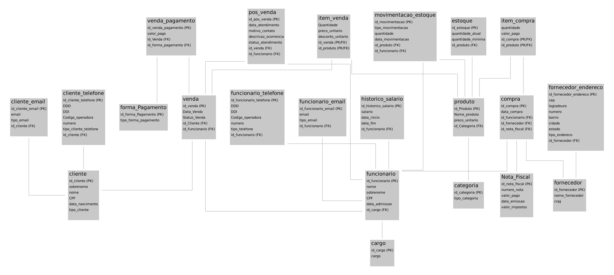

# Modelo Lógico Relacional — ERP Start Campos

> Entrega final — Projeto Integrador de Modelagem de Dados (Prof. Clóvis) — Grupo 2.
> O modelo lógico corresponde exatamente ao script [`sql/ddl/01_estrutura.sql`](../../sql/ddl/01_estrutura.sql): 22 tabelas.



Notação (a mesma das aulas): cada tabela com seus campos; **(PK)** chave primária, **(FK)** chave estrangeira, **(PK/FK)** campo que faz parte da chave primária e também referencia outra tabela.

Caminho seguido, conforme o manual da entrega final:

```text
ENTIDADE → TABELA → PK → RELACIONAMENTOS (FK) → N:N → 1FN → 2FN → 3FN → RESTRIÇÕES
```

---

## 1. Conversão das entidades em tabelas

| Entidade do DER | Tabela | Classificação | Por quê |
|---|---|---|---|
| Cliente | `cliente` | Forte | Identificador próprio |
| Cliente.telefone (multivalorado) | `cliente_telefone` | Forte (vinda da 1FN) | Um cliente tem vários telefones — caso 1.1 |
| Cliente.email (multivalorado) | `cliente_email` | Forte (vinda da 1FN) | Um cliente tem vários e-mails — caso 1.1 |
| Funcionario | `funcionario` | Forte | Identificador próprio |
| Funcionario.telefone / email | `funcionario_telefone`, `funcionario_email` | Forte (vinda da 1FN) | Caso 1.1 |
| Cargo | `cargo` | Forte | Separado do funcionário na 3FN — caso 3.1 |
| HistoricoSalario | `historico_salario` | Forte | Guarda o salário de cada período |
| Categoria | `categoria` | Forte | Identificador próprio |
| Produto | `produto` | Forte | Identificador próprio |
| Estoque | `estoque` | Forte | Saldo e mínimo de cada produto (1:1) |
| MovimentacaoEstoque | `movimentacao_estoque` | Forte | Histórico do estoque |
| Fornecedor | `fornecedor` | Forte | Identificador próprio |
| Fornecedor.endereco (multivalorado e composto) | `fornecedor_endereco` | Forte (vinda da 1FN) | Sede, filial, armazém... — caso 1.2 |
| NotaFiscal | `Nota_Fiscal` | Forte | Separada da compra na 3FN — caso 3.2 |
| Compra | `compra` | Forte | Identificador próprio |
| ItemCompra | `item_compra` | **Associativa** | Resolve o N:N Compra × Produto e guarda quantidade e valor pago |
| Venda | `venda` | Forte | Identificador próprio |
| ItemVenda | `item_venda` | **Associativa** | Resolve o N:N Venda × Produto e guarda quantidade, preço praticado e desconto |
| FormaPagamento | `forma_Pagamento` | Forte | Cadastro das formas aceitas |
| VendaPagamento | `venda_pagamento` | Forte | Cada pagamento recebido, com identificador próprio |
| PosVenda | `pos_venda` | Forte | Identificador próprio |

**Entidades fracas:** o modelo não tem. Nenhuma tabela depende da chave de outra para ser identificada: as tabelas da 1FN e os pagamentos têm identificador próprio. Os itens são associativos, porque surgiram para resolver relacionamentos N:N e herdam as chaves das duas tabelas. Seguindo a aula, nenhuma entidade fraca foi criada artificialmente.

---

## 2. Chaves primárias

| Tabela | PK | Por que é uma boa chave |
|---|---|---|
| Tabelas fortes | `id_...` `INT AUTO_INCREMENT` | Identifica cada registro de forma única, não se repete, não muda e não depende de dado que possa ser corrigido. CPF e CNPJ não foram usados como PK porque podem ser digitados errado e corrigidos depois; eles são protegidos com UNIQUE |
| `item_venda` | `(id_venda, id_produto)` | Cada produto aparece uma vez em cada venda; a quantidade fica em `Quantidade`. A PK herda as chaves das duas tabelas do N:N (manual, Etapa 6) |
| `item_compra` | `(id_compra, id_produto)` | Mesmo raciocínio: um produto por linha da compra |

---

## 3. Conversão dos relacionamentos e das cardinalidades

Regras aplicadas: no **1:N**, a FK fica do lado N; no **N:N**, nasce uma tabela associativa; no **1:1**, a FK recebe UNIQUE; participação mínima 1 vira FK **NOT NULL**.

| Relacionamento do DER | Cardinalidade | Como ficou nas tabelas |
|---|---|---|
| Cliente realiza Venda | (0,N) : (1,1) | `venda.id_Cliente` FK **NOT NULL**: toda venda tem cliente (RN08 revisada) |
| Funcionario registra Venda | (0,N) : (1,1) | `venda.id_Funcionario` FK NOT NULL (RN10) |
| Venda contém Produto | N:N | Associativa **`item_venda`** — PK `(id_venda, id_produto)` |
| Venda recebe VendaPagamento | (0,N) : (1,1) | `venda_pagamento.id_Venda` FK NOT NULL; vários pagamentos por venda (RN11) |
| FormaPagamento é usada em VendaPagamento | (0,N) : (1,1) | `venda_pagamento.id_forma_pagamento` FK NOT NULL |
| Venda origina PosVenda | (0,N) : (1,1) | `pos_venda.id_venda` FK NOT NULL |
| Funcionario atende PosVenda | (0,N) : (1,1) | `pos_venda.id_funcionario` FK NOT NULL (RN30) |
| Cargo é ocupado por Funcionario | (0,N) : (1,1) | `funcionario.id_cargo` FK NOT NULL |
| Funcionario recebe HistoricoSalario | (0,N) : (1,1) | `historico_salario.id_funcionario` FK NOT NULL |
| Cliente possui telefones / e-mails | (0,N) : (1,1) | `cliente_telefone.id_cliente` FK NOT NULL; `cliente_email.id_cliente` FK (no script, aceita NULL) |
| Funcionario possui telefones / e-mails | (0,N) : (1,1) | `funcionario_telefone.id_funcionario` e `funcionario_email.id_funcionario` FK NOT NULL |
| Categoria classifica Produto | (0,N) : (1,1) | `produto.id_Categoria` FK NOT NULL (RN01) |
| Produto controla Estoque | (0,1) : (1,1) | `estoque.id_produto` FK NOT NULL **+ UNIQUE**: um registro de estoque por produto |
| Produto possui MovimentacaoEstoque | (0,N) : (1,1) | `movimentacao_estoque.id_produto` FK NOT NULL (RN28) |
| Funcionario executa MovimentacaoEstoque | (0,N) : (1,1) | `movimentacao_estoque.id_funcionario` FK NOT NULL (RN29) |
| Fornecedor possui endereços | (0,N) : (1,1) | `fornecedor_endereco.id_fornecedor` FK NOT NULL |
| Fornecedor atende Compra | (0,N) : (1,1) | `compra.id_fornecedor` FK NOT NULL (RN14) |
| Funcionario registra Compra | (0,N) : (1,1) | `compra.id_funcionario` FK NOT NULL (RN14) |
| NotaFiscal documenta Compra | (0,N) : (1,1) | `compra.id_nota_fiscal` FK NOT NULL: toda compra tem nota. O lado da nota é (0,N) porque a FK não tem UNIQUE; a regra "uma nota por compra" é conferida pela auditoria A6 |
| Compra contém Produto | N:N | Associativa **`item_compra`** — PK `(id_compra, id_produto)` |

**Ciclo de vida da venda (devolutiva):** a cardinalidade Venda–ItemVenda é **(0,N)**. A venda pode ser criada com `Status_Venda = 'EM ANDAMENTO'` antes de receber itens; a exigência de pelo menos um item vale para a venda `CONCLUIDO` (RN03 revisada). Como envolve duas tabelas, essa regra é conferida pela consulta de auditoria A1.

---

## 4. Normalização

Formato do manual: **estrutura analisada → dependência funcional → problema → correção**. Todos os casos vieram do DER da primeira entrega ou do primeiro diagrama de tabelas da equipe; nenhum erro foi inventado.

### 4.1 Primeira Forma Normal — "UM CAMPO → UM VALOR"

**Caso 1.1 — Telefone e e-mail de cliente e funcionário**

```
ANTES (DER da 1ª entrega)
CLIENTE(id_cliente, nome, cpf, telefone, email, ...)       telefone multivalorado

DEPENDÊNCIA
id_cliente → {telefone₁, telefone₂, ...}

PROBLEMA
Vários telefones no mesmo campo ou colunas telefone1, telefone2 (grupo repetitivo).
O mesmo vale para e-mail e para o funcionário.

DEPOIS
cliente(id_cliente, sobrenome, nome, CPF, data_nascimento, tipo_cliente)
cliente_telefone(id_cliente_telefone, DDD, DDI, Codigo_operadora, numero, tipo_cliente_telefone, id_cliente)
cliente_email(id_cliente_email, email, tipo_email, id_cliente)
funcionario_telefone(...), funcionario_email(...)
```

O telefone também foi dividido em DDI, DDD, código da operadora e número, que são valores atômicos.

**Caso 1.2 — Endereço do fornecedor**

```
ANTES (1º diagrama de tabelas da equipe)
Fornecedor(id_fornecedor, id_produto, endereço_fornecedor, quantidade, cnpj)

PROBLEMA
endereço_fornecedor juntava CEP, rua, número, bairro, cidade e UF num campo só (composto),
e um fornecedor pode ter vários endereços (sede, filial, armazém) — multivalorado.

DEPOIS
fornecedor_endereco(id_fornecedor_endereco, cep, logradouro, numero, bairro, cidade,
                    estado, tipo_endereco, id_fornecedor)
```

É o mesmo caso do exemplo do manual: "Endereço — atributo → tabela — foi necessário armazenar vários endereços".

**Caso 1.3 — Produto no pagamento**

```
ANTES (1º diagrama da equipe)
Venda_Pagamento(id_Venda_Pagamento, valor_pago, id_Venda, id_forma_pagamento, id_produto)

DEPENDÊNCIAS
id_Venda_Pagamento → valor_pago, id_Venda, id_forma_pagamento
id_Venda → {produto₁, produto₂, ...}   (os produtos são da venda)

PROBLEMA
O pagamento quita a venda inteira (RN11). Numa venda com três produtos, id_produto
teria de guardar três valores — ou o pagamento teria de ser repetido.

DEPOIS
venda_pagamento(id_venda_pagamento, valor_pago, id_Venda, id_forma_pagamento)
Os produtos ficam em item_venda.
```

### 4.2 Segunda Forma Normal — "DEPENDE DA CHAVE TODA?"

**Caso 2.1 — Fornecedor e produto**

```
ANTES (1º diagrama da equipe)
Fornecedor(id_fornecedor, id_produto, endereço_fornecedor, quantidade, cnpj)

Para um fornecedor ter vários produtos, a chave teria de ser (id_fornecedor, id_produto).

DEPENDÊNCIAS
id_fornecedor → endereço_fornecedor, cnpj           (só parte da chave)
(id_fornecedor, id_produto) → quantidade              (chave toda)

PROBLEMA
Dependência parcial: CNPJ e endereço se repetiriam em cada produto do fornecedor.

DEPOIS
fornecedor(id_fornecedor, nome_fornecedor, cnpj)
Os produtos que cada fornecedor entrega aparecem pelas compras (compra + item_compra).
```

**Caso 2.2 — Compra e produto**

```
ANTES (1º diagrama da equipe)
Compra(id_compra, data_compra, id_produto, id_funcionario, id_fornecedor, valor_total, nota_fiscal)

Uma compra tem vários produtos; a chave teria de ser (id_compra, id_produto).

DEPENDÊNCIAS
id_compra → data_compra, id_funcionario, id_fornecedor, nota_fiscal   (só parte da chave)

PROBLEMA
Dependência parcial: data, fornecedor e nota se repetiriam em cada produto da compra.

DEPOIS
compra(id_compra, data_compra, id_funcionario, id_fornecedor, id_nota_fiscal)
item_compra(quantidade, valor_pago, id_compra, id_produto)
```

**Verificação das tabelas com PK composta**

| Tabela | Dependência | Resultado |
|---|---|---|
| `item_venda` | `(id_venda, id_produto) → Quantidade, preco_unitario, desconto_unitario` | ✔ 2FN. Data e cliente dependem só de `id_venda` e estão em `venda`; o nome do produto depende só de `id_produto` e está em `produto` |
| `item_compra` | `(id_compra, id_produto) → quantidade, valor_pago` | ✔ 2FN |

### 4.3 Terceira Forma Normal — "DEPENDE DA CHAVE OU DE OUTRO ATRIBUTO?"

**Caso 3.1 — Cargo do funcionário**

```
ANTES (DER da 1ª entrega)
FUNCIONARIO(id_funcionario, nome, cpf, cargo, ...)

DEPENDÊNCIAS
id_funcionario → cargo   e   cargo → dados do cargo

PROBLEMA
O cargo é um cadastro próprio; guardado como texto em cada funcionário, se repete e pode
ser escrito de formas diferentes ("Vendedor", "vendedor", "Vend.").

DEPOIS
cargo(id_cargo, cargo)
funcionario(id_funcionario, nome, sobrenome, CPF, data_admissao, id_cargo)
```

A mesma decisão separou `categoria` de `produto` e `forma_Pagamento` de `venda_pagamento`.

**Caso 3.2 — Nota fiscal da compra**

```
ANTES (1º diagrama da equipe)
Compra(id_compra, ..., valor_total, nota_fiscal)

DEPENDÊNCIAS
id_compra → nota_fiscal
nota_fiscal → valor, data de emissão, impostos

PROBLEMA
Dependência transitiva: os dados da nota dependem do número da nota, não da compra.

DEPOIS
Nota_Fiscal(id_nota_fiscal, numero_nota, valor_pago, data_emissao, valor_impostos)
compra(id_compra, data_compra, id_funcionario, id_fornecedor, id_nota_fiscal)
```

**Caso 3.3 — Frete e totais da venda**

```
ANTES (DER da 1ª entrega)
VENDA(id_venda, ..., subtotal, desconto_total, frete, valor_total)

DEPENDÊNCIAS
subtotal, desconto_total, valor_total → calculados a partir dos itens da venda

PROBLEMA
Valores derivados guardados na venda: alterar um item e esquecer o total gera dado contraditório.

DEPOIS
venda(id_venda, Data_Venda, Status_Venda, id_Cliente, id_Funcionario)
O valor da venda é calculado nas consultas: soma de Quantidade × (preco_unitario − desconto_unitario).
```

**Situações analisadas e mantidas**

| Situação | Por que foi mantida |
|---|---|
| `item_venda.preco_unitario` × `produto.preco_unitario` | Não é cópia: o item guarda o preço praticado naquela venda; o produto guarda o preço de tabela, que pode mudar depois |
| `estoque.quantidade_atual` | Pode ser calculado pelas movimentações, mas fica guardado para a consulta rápida do saldo (RF13). É uma redundância controlada: a auditoria A7 confere se bate com entradas − saídas |
| `Nota_Fiscal.valor_pago` | É o valor impresso no documento fiscal, não um cálculo do sistema. A auditoria A5 confere se bate com a soma dos itens |

### 4.4 Resultado

| Tabela | 1FN | 2FN | 3FN |
|---|:---:|:---:|:---:|
| cliente, cliente_telefone, cliente_email | ✔ (1.1) | n/a (PK simples) | ✔ |
| funcionario, funcionario_telefone, funcionario_email | ✔ (1.1) | n/a | ✔ (3.1) |
| cargo, historico_salario | ✔ | n/a | ✔ |
| categoria, produto, estoque, movimentacao_estoque | ✔ | n/a | ✔ |
| fornecedor, fornecedor_endereco | ✔ (1.2) | ✔ (2.1) | ✔ |
| Nota_Fiscal, compra | ✔ | ✔ (2.2) | ✔ (3.2) |
| item_compra | ✔ | ✔ | ✔ |
| venda | ✔ | n/a | ✔ (3.3) |
| item_venda | ✔ | ✔ | ✔ |
| forma_Pagamento, venda_pagamento | ✔ (1.3) | n/a | ✔ |
| pos_venda | ✔ | n/a | ✔ |

---

## 5. Restrições

Cada restrição do script protege uma regra do negócio (Aula 9: "de onde vem cada restrição?").

| Regra | Restrição | Onde |
|---|---|---|
| CPF do cliente não se repete (RF05) | UNIQUE + NOT NULL | `cliente.CPF` |
| CPF do funcionário não se repete | UNIQUE + NOT NULL | `funcionario.CPF` |
| CNPJ do fornecedor não se repete | UNIQUE + NOT NULL | `fornecedor.cnpj` |
| A mesma nota não é lançada duas vezes | UNIQUE + NOT NULL | `Nota_Fiscal.numero_nota` |
| Cliente é pessoa física ou jurídica | CHECK `tipo_cliente IN (...)` | `cliente` |
| Categorias do catálogo | CHECK `tipo_categoria IN ('JOGOS','ACESSORIOS','CONSOLES')` | `categoria` |
| Cargos da loja | CHECK `cargo IN ('VENDEDOR')` | `cargo` |
| Formas de pagamento aceitas (RF19) | CHECK `tipo_forma_pagamento IN (...)` | `forma_Pagamento` |
| Tipos de telefone, e-mail e endereço | CHECK `... IN (...)` | tabelas de telefone, e-mail e endereço |
| Preço e salário não negativos | CHECK `>= 0` | `produto.preco_unitario`, `historico_salario.salario` |
| Quantidade positiva | CHECK `> 0` | `item_venda`, `item_compra`, `movimentacao_estoque` |
| Valor pago no item de compra não negativo | CHECK `>= 0` | `item_compra.valor_pago` |
| Estoque nunca negativo (RN05) | CHECK `quantidade_atual >= 0` | `estoque` |
| Estoque mínimo não negativo (RF13) | CHECK `quantidade_minima >= 0` | `estoque` |
| Um registro de estoque por produto | UNIQUE + NOT NULL | `estoque.id_produto` |
| Ciclo de vida da venda (devolutiva) | CHECK `Status_Venda IN ('CONCLUIDO','PENDENTE','EM ANDAMENTO')` | `venda` |
| Situação do atendimento | CHECK `status_atendimento IN (...)` | `pos_venda` |
| Tipo de movimentação (RF12) | CHECK `tipo_movimentacao IN ('ENTRADA','SAIDA','AJUSTE')` | `movimentacao_estoque` |
| Um produto aparece uma vez por venda / compra | PK composta | `item_venda`, `item_compra` |
| Toda operação aponta para registros existentes | FOREIGN KEY | todas as FKs |
| Produto, cliente, funcionário, fornecedor, cargo e categoria em uso não podem ser excluídos (RN22) | `ON DELETE RESTRICT` | FKs de venda, compra, itens (lado produto), movimentação e pós-venda |
| Telefones, e-mails e endereços pertencem ao dono | `ON DELETE CASCADE` | tabelas da 1FN |
| Venda com pós-venda não pode ser excluída (RN22) | `ON DELETE RESTRICT` | `pos_venda.id_venda` |
| Data da compra preenchida automaticamente | DEFAULT `CURRENT_TIMESTAMP` | `compra.data_compra` |

### 5.1 Regras que não cabem em uma constraint simples

Envolvem mais de uma tabela (Aula 9). Ficam documentadas e são verificadas por [`sql/auditoria/05_auditoria.sql`](../../sql/auditoria/05_auditoria.sql).

| Regra | Auditoria |
|---|---|
| Venda concluída tem pelo menos um item (RN03, devolutiva) | A1 |
| Pagamentos da venda concluída somam o valor da venda (RN12) | A2 |
| Compra tem pelo menos um item (RN15) | A4 |
| Valor da nota = soma dos itens da compra | A5 |
| Cada nota documenta uma única compra | A6 |
| Saldo do estoque = entradas − saídas | A7 |
| Todo produto tem registro de estoque | A9 |
| Um único salário em vigor por funcionário | A12 |

---

## 6. Modelo lógico final

Tabelas na ordem de criação do script (independentes primeiro).

**cliente** — forte

```
cliente
 id_cliente (PK)
 sobrenome
 nome
 CPF
 data_nascimento
 tipo_cliente
```

**categoria** — forte

```
categoria
 id_categoria (PK)
 tipo_categoria
```

**cargo** — forte

```
cargo
 id_cargo (PK)
 cargo
```

**forma_Pagamento** — forte

```
forma_Pagamento
 id_forma_Pagamento (PK)
 tipo_forma_pagamento
```

**Nota_Fiscal** — forte

```
Nota_Fiscal
 id_nota_fiscal (PK)
 numero_nota
 valor_pago
 data_emissao
 valor_impostos
```

**fornecedor** — forte

```
fornecedor
 id_fornecedor (PK)
 nome_fornecedor
 cnpj
```

**cliente_email** — forte (vinda da 1fn)

```
cliente_email
 id_cliente_email (PK)
 email
 tipo_email
 id_cliente (FK)
```

**cliente_telefone** — forte (vinda da 1fn)

```
cliente_telefone
 id_cliente_telefone (PK)
 DDD
 DDI
 Codigo_operadora
 numero
 tipo_cliente_telefone
 id_cliente (FK)
```

**funcionario** — forte

```
funcionario
 id_funcionario (PK)
 nome
 sobrenome
 CPF
 data_admissao
 id_cargo (FK)
```

**produto** — forte

```
produto
 id_Produto (PK)
 Nome_produto
 preco_unitario
 id_Categoria (FK)
```

**fornecedor_endereco** — forte (vinda da 1fn)

```
fornecedor_endereco
 id_fornecedor_endereco (PK)
 cep
 logradouro
 numero
 bairro
 cidade
 estado
 tipo_endereco
 id_fornecedor (FK)
```

**historico_salario** — forte

```
historico_salario
 id_historico_salario (PK)
 salario
 data_inicio
 data_fim
 id_funcionario (FK)
```

**estoque** — forte

```
estoque
 id_estoque (PK)
 quantidade_atual
 quantidade_minima
 id_produto (FK)
```

**funcionario_telefone** — forte (vinda da 1fn)

```
funcionario_telefone
 id_funcionario_telefone (PK)
 DDD
 DDI
 Codigo_operadora
 numero
 tipo_telefone
 id_funcionario (FK)
```

**funcionario_email** — forte (vinda da 1fn)

```
funcionario_email
 id_funcionario_email (PK)
 email
 tipo_email
 id_funcionario (FK)
```

**venda** — forte

```
venda
 id_venda (PK)
 Data_Venda
 Status_Venda
 id_Cliente (FK)
 id_Funcionario (FK)
```

**compra** — forte

```
compra
 id_compra (PK)
 data_compra
 id_funcionario (FK)
 id_fornecedor (FK)
 id_nota_fiscal (FK)
```

**movimentacao_estoque** — forte

```
movimentacao_estoque
 id_movimentacao (PK)
 tipo_movimentacao
 quantidade
 data_movimentacao
 id_produto (FK)
 id_funcionario (FK)
```

**item_venda** — associativa

```
item_venda
 Quantidade
 preco_unitario
 desconto_unitario
 id_venda (PK/FK)
 id_produto (PK/FK)
```

**venda_pagamento** — forte

```
venda_pagamento
 id_venda_pagamento (PK)
 valor_pago
 id_Venda (FK)
 id_forma_pagamento (FK)
```

**item_compra** — associativa

```
item_compra
 quantidade
 valor_pago
 id_compra (PK/FK)
 id_produto (PK/FK)
```

**pos_venda** — forte

```
pos_venda
 id_pos_venda (PK)
 data_atendimento
 motivo_contato
 descricao_ocorrencia
 status_atendimento
 id_venda (FK)
 id_funcionario (FK)
```

